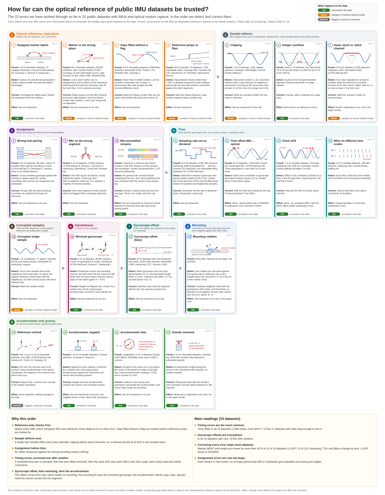
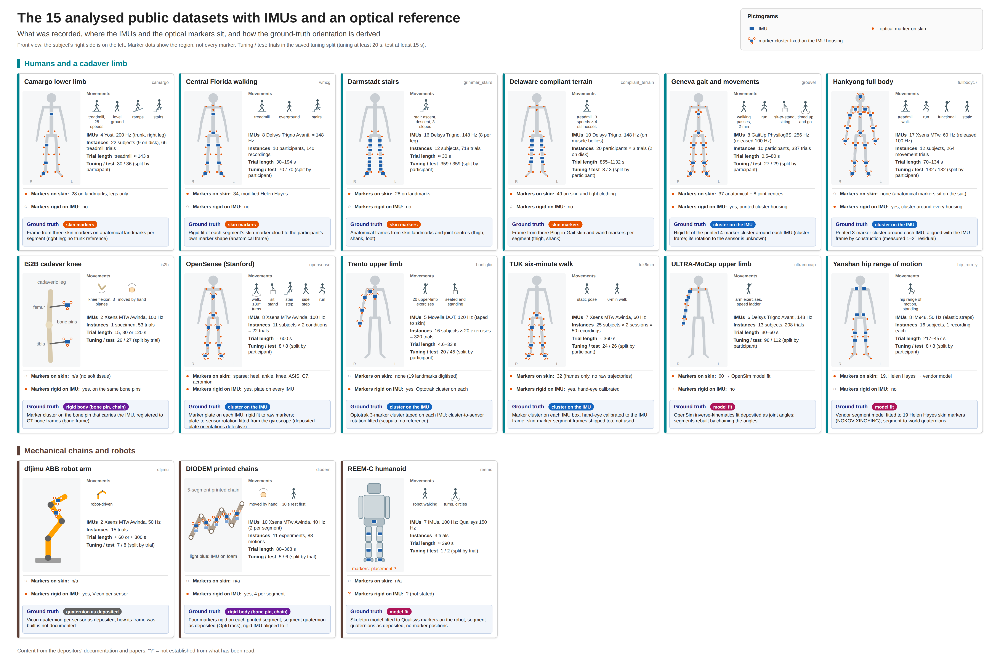

# IMUnity: errors in public IMU datasets with an optical motion-capture reference

Code to detect and correct the errors found in public datasets that record inertial sensors (IMUs) together with an
optical motion-capture reference, and to measure how the corrections change relative orientation (joint angle)
estimation with two state-of-the-art filters: a multiplicative extended Kalman filter (MEKF) and the Li-EKF (`zoe` in
the code). The code covers 18 datasets: the 15 used in the paper, plus three that are supported but not used for the
paper (the printed four-segment chain `mfimt_d01`, OpenAXES and RepoIMU).



## How to read this repository

```
images/                      visual abstract (errors in the order of correction) and dataset overview
docs/errors/                 one page per error: detection rule, correction, prevalence and a worked example
splits/                      saved tuning/test split of every dataset (used by the effect analysis)
src/imunity/
  recording.py               the common data model: Recording -> Segment -> ImuStream + ReferenceStream
  datasets/                  one loader per dataset; every loader returns the same Recording structure
  errors/                    one module per error, named by its number in the order of correction:
    e01_label_swaps.py ... e22_gravity_removed.py
                             each has check_for_<error>(recording), remove_<error>(...) and
                             handle_<error>(datasets) -> ErrorReport
    _report.py               ErrorReport: prevalence per dataset, per-trial rows, notes, corrected data
  download.py                download(): every dataset from its original depositor, checked, in the loaders' layout
  correction.py              correct_in_order(): all errors corrected in the agreed order
  effect_analysis.py         EffectAnalysis: influence of the corrections on the MEKF and/or the Li-EKF
  effect.py, zoe.py          the two estimators (MEKF; Li-EKF, `zoe`), tuning and scoring
  soft_tissue.py             soft-tissue motion between IMU and skin-marker segment frame (with main findings)
  motion_onset.py, tuning_split.py, rotations.py, resample.py, synthetic.py   helpers
tests/                       known-answer tests: for every error a synthetic recording with an injected
                             defect is recovered and a clean one is not flagged
```

Conventions: units are s, rad/s and m/s². Loaders never repair anything. A check returns `detected` True, False or
None (undecided); not detected is not absent. A correction returns a copy with a log entry
(`recording.corrections`) and marks samples it cannot repair invalid instead of inventing values.

## Setup

```bash
uv sync
uv run pytest -q          # about 3 minutes
```

### Get the data

The data are not part of the repository. `imunity.download` fetches every dataset from the host where its
depositors published it and unpacks it into the layout the loaders read:

```bash
uv run python -m imunity.download                       # all 18 datasets (the default, same as 'all')
uv run python -m imunity.download paper                 # the 15 datasets used in the paper
uv run python -m imunity.download is2b dfjimu reemc     # a subset
```

```python
from imunity.download import download, DATASETS
download('paper')                    # the 15 of imunity.datasets.PAPER_DATASETS; download() or 'all': all 18
download(['is2b', 'grouvel'])        # {'is2b': 'done', 'grouvel': 'done'}
DATASETS['is2b']                     # host, DOI, licence and the files taken
```

- **Where**: `<IMUNITY_DATA>/<dataset>/`; if that variable is not set, `data/` in this repository. Files
  derived from the deposits (the OpenSense reference rebuilt from the markers, the Geneva IMU streams rebuilt from
  the raw logs) go to `IMUNITY_PREPARED`, default `<IMUNITY_DATA>/_prepared`. Set both before importing
  `imunity`.
- **What**: only the files the loaders read, and the participants our results are based on: Delaware compliant
  terrain SUB01-SUB02 (`--all-participants` adds SUB03-SUB20, 54 GB, not used in the paper) and Camargo part 1
  (AB06-AB14). About 61 GB to download.
- **Checks**: every file is checked against the checksum its host publishes, or against the checksum of the copy
  our results were computed on; the two GitHub sources are pinned to a commit. Interrupted downloads resume; a
  finished dataset is skipped on the next call.
- **By hand**: OpenSense is on SimTK, which allows downloads only after a (free) login: put `study20-latest.tar.gz`
  from https://simtk.org/plugins/datashare/?group_id=2164 into `<IMUNITY_DATA>/opensense/` and run the download
  again, which checks and unpacks it. The printed four-segment chain (`mfimt_d01`) is not publicly deposited; its
  file `chain_experiment_d01.npz` goes into `<IMUNITY_DATA>/mfimt/`.
- **After Geneva**: the download rebuilds Geneva's IMU streams from its raw session logs (about a minute), which the
  correction of the mis-assembled streams (error 10) reads.
- **Tools**: Hip-ROM-Y is a RAR5 archive; unpacking it needs `bsdtar` (libarchive), `7zz`, `unrar` or `unar`.

Every loader also accepts `root=...` for data elsewhere; the robot arm (`dfjimu`) and the printed chain
(`mfimt_d01`) can also be pointed elsewhere with `IMUNITY_DFJIMU` and `IMUNITY_MFIMT`. Loader tests are skipped
when a dataset is not found.

## The datasets



Short names: `tuk6min`, `opensense`, `fullbody17`, `camargo`, `wmcg`, `compliant_terrain`, `hip_rom_y`, `is2b`,
`grouvel`, `bonfiglio`, `grimmer_stairs`, `ultramocap`, `diodem`, `dfjimu`, `mfimt_d01` (not used for the paper),
`reemc`, `openaxes` (not used for the paper), `repoimu` (not used for the paper). The lists in `imunity.datasets`:
`ALL_DATASETS` (all 18), `PAPER_DATASETS` (the 15 used in the paper) and `EXTRA_DATASETS` (the three not used for
the paper: `mfimt_d01`, `openaxes`, `repoimu`; they have loaders, a download and a saved split and run through every
check, correction and the effect analysis). The error handlers and the effect analysis default to all 18; pass
`PAPER_DATASETS` for the paper's set.

Four helper readers exist besides them (`imunity.datasets.HELPER_READERS`); they are not datasets of their own:

| Reader | What it reads |
|---|---|
| `grouvel_raw` | Geneva with its IMU streams rebuilt from the raw session logs (the correction of the mis-assembled streams, error 10) |
| `bonfiglio_deposited` | Trento with the deposit's own trial pairing (the k-th IMU trial with the k-th optical file), read for the trial-pairing check (error 8) |
| `bonfiglio_final_deposited` | Trento read from the authors' own processed files (`B_dotComplete`, `qGS_Optotrack`), with their pairing |
| `bonfiglio_final` | Trento read from the authors' own processed files, re-paired by the trial-pairing check (error 8) |

### Load one or several datasets

```python
from imunity.datasets import load_dataset, PAPER_DATASETS

loader = load_dataset('dfjimu')
print(loader.trials()[:3])
rec = loader.load(loader.trials()[0])
for name, seg in rec.segments.items():
    print(name, seg.imu.gyr.shape, seg.imu.rate_hz, len(seg.reference.orientation), seg.reference.rate_hz)
print(rec.joints, rec.participant, rec.session)

for name in ['is2b', 'hip_rom_y', 'camargo']:          # several datasets: the same structure for each
    loader = load_dataset(name)
    for rec in loader:                                  # every trial
        ...
```

## The errors

Numbered in the order in which they are detected and corrected: the check of error N runs on data already corrected
for every error with a smaller number, with one exception: gaps filled without a flag (4) are masked before reference
jumps or flips (3) are looked for, so the jump check runs on data corrected for errors 1, 2 and 4, and the gap check
on data corrected for errors 1 and 2 (`imunity.correction.SEQUENCE`). *fix* = repaired, *mask* = samples or frames marked invalid,
*report* = flagged only.

| # | Error | Module | Data |
|---|---|---|---|
| 1 | [Swapped marker labels (within a cluster)](docs/errors/01-swapped-marker-labels.md) | `e01_label_swaps` | fix |
| 2 | [Marker in the wrong place](docs/errors/02-marker-in-wrong-place.md) | `e02_misplaced_markers` | mask (rigid clusters) / report (skin clusters) |
| 3 | [Reference jumps or flips](docs/errors/03-reference-jumps-or-flips.md) | `e03_reference_jumps` | mask |
| 4 | [Gaps filled without a flag](docs/errors/04-gaps-filled-without-flag.md) | `e04_gap_fill` | mask |
| 5 | [Clipping](docs/errors/05-clipping.md) | `e05_clipping` | mask |
| 6 | [Integer overflow](docs/errors/06-integer-overflow.md) | `e06_integer_overflow` | fix |
| 7 | [Dead, stuck or railed channel](docs/errors/07-dead-stuck-or-railed-channel.md) | `e07_dead_channels` | mask |
| 8 | [Wrong trial pairing](docs/errors/08-wrong-trial-pairing.md) | `e08_trial_pairing` | fix |
| 9 | [IMU on the wrong segment](docs/errors/09-imu-on-wrong-segment.md) | `e09_segment_assignment` | fix |
| 10 | [Mis-assembled streams](docs/errors/10-mis-assembled-streams.md) | `e10_mis_assembled_streams` | fix |
| 11 | [Sampling rate not as declared](docs/errors/11-sampling-rate-not-as-declared.md) | `e11_sampling_rate` | fix |
| 12 | [Time offset between IMU and reference](docs/errors/12-time-offset.md) | `e12_time_offset` | fix |
| 13 | [Clock drift between IMU and reference](docs/errors/13-clock-drift.md) | `e13_clock_drift` | fix |
| 14 | [IMUs of one trial on different time scales](docs/errors/14-imus-on-different-time-scales.md) | `e14_time_scales` | fix |
| 15 | [Corrupted single samples](docs/errors/15-corrupted-single-samples.md) | `e15_corrupted_samples` | mask |
| 16 | [Mirrored gyroscope or single flipped axis](docs/errors/16-mirrored-gyroscope.md) | `e16_mirrored_gyroscope` | fix |
| 17 | [Gyroscope offset](docs/errors/17-gyroscope-offset.md) | `e17_gyroscope_offset` | fix |
| 18 | [Mounting rotation](docs/errors/18-mounting-rotation.md) | `e18_mounting` | fix |
| 19 | [Reference vertical not +z](docs/errors/19-reference-vertical-not-z.md) | `e19_e20_accelerometer_sign` | report |
| 20 | [Accelerometer negated](docs/errors/20-accelerometer-negated.md) | `e19_e20_accelerometer_sign` | fix |
| 21 | [Accelerometer bias](docs/errors/21-accelerometer-bias.md) | `e21_accelerometer_bias` | fix |
| 22 | [Gravity removed from the accelerometer](docs/errors/22-gravity-removed.md) | `e22_gravity_removed` | fix |

Each error's page (linked in the table) explains the detection rule and its thresholds, the correction, where the error
occurs and a worked example with a figure. Each module's docstring states the same rule in full; its known-answer test
is `tests/test_eNN_<name>.py`.

### Handle a specific error

Every error has one function `handle_<error>(datasets, data=..., notes=..., processes=...)`. It works for any subset
of the datasets and returns an `ErrorReport`:

```python
from imunity.errors import handle_time_offset

report = handle_time_offset(['dfjimu', 'is2b'], processes=8)   # data='deposited': the files as published
print(report)              # prevalence per dataset: trials checked, trials with the error, occurrences, undecided
report.prevalence          # the same as a table
report.rows                # one row per checked trial (or trial and segment), with the estimate
report.add_note('is2b', 'offset larger in the 120 s trials; check the trigger')   # notes on suspicious findings
fixed = report.corrected('is2b')          # a loader that returns the trials with this error corrected
rec = fixed.load(fixed.trials()[0])
print(rec.corrections)                    # what was changed
report.save('output')                     # prevalence.csv, rows.csv, notes.json
```

`data='in_order'` runs the check on data corrected for every earlier error (the prevalence in the order of
correction); `data='deposited'` on the published files (the independent prevalence, which also counts errors caused
by other errors). Notes can also be passed directly: `handle_clipping(['camargo'], notes={'camargo': '...'})`.

On a single recording, the check and the correction can be called directly:

```python
from imunity import errors

result = errors.check_for_synchronisation_offset(rec)
print(result)                                   # detected or not, with the estimate in plain words
fixed = errors.remove_synchronisation_offset(rec, result)
```

### Correct all errors in the agreed order

```python
from imunity.correction import correct_in_order, run_in_order, prevalence_table

loader = correct_in_order('camargo', cache_dir='output/cache')           # every handled error corrected
loader = correct_in_order('camargo', up_to=12, cache_dir='output/cache') # up to and including error 12
reports = run_in_order(['camargo', 'wmcg'], cache_dir='output/cache')     # {number: ErrorReport}
print(prevalence_table(reports))                                         # 'trials / occurrences' per error
```

Several corrections pool all trials of a participant or session, so each check runs over the whole dataset once;
with `cache_dir` the results are kept and later calls read them back.

## Influence on relative orientation estimation (MEKF, Li-EKF or both)

```python
from imunity.effect_analysis import EffectAnalysis

ea = EffectAnalysis(['dfjimu', 'is2b'], methods=('MEKF', 'zoe'), processes=8, cache_dir='output/cache')
summary = ea.run()        # per dataset and method: tuned R and Q, test error (median, mean) per condition
ea.tests                  # per test trial and joint: error in degrees per condition

EffectAnalysis('is2b', methods='MEKF').run()     # only the MEKF
EffectAnalysis('is2b', methods='zoe').run()      # only the Li-EKF
EffectAnalysis.for_error(18, ['is2b']).run()     # one error alone: corrected for 1-17 against 1-18
```

`methods` names the filters by their code identifiers: `'MEKF'` and `'zoe'` (the Li-EKF). By default the conditions
are the data as published (`deposited`) and the data with every handled error corrected in the agreed order
(`corrected`). For Trento the `deposited` condition reads the authors' own processed files with their pairing
(`bonfiglio_final_deposited`, `effect_analysis.DEPOSITED_READER`), the data as a user of the deposit gets them; the
`corrected` condition starts from the raw files (`bonfiglio`). For each dataset, condition and method, one parameter
pair is tuned on the tuning half of the saved split and the error is measured on the test half; scoring starts 10 s
after the motion onset. The full procedure is in the docstring of `effect_analysis.py`.

## Soft-tissue motion

Not one of the numbered errors, but a property of every skin-marker reference. `soft_tissue.py` measures how far an
IMU (its housing's marker cluster) and its skin-marker segment frame move against each other, in the three datasets
that carry both (TUK six-minute walk, Geneva gait, Hankyong full body), and the floor this sets for a joint angle.

```python
from imunity.soft_tissue import segment_motion, joint_floor, summarize

segments, joints = summarize(segment_motion(processes=8), joint_floor(processes=8))
```

Main findings: the time-varying part is typically 1-5° per segment (median per trial) and 3-17° at the 95th
percentile, largest for the Geneva thigh and the Hankyong upper arm. The joint-level floor is 4.3° (TUK), 6.2°
(Geneva) and 4.9° (Hankyong) as the mean over a trial's joints, 6-8° for hip, knee and elbow in some datasets: an
IMU estimate cannot be expected to agree with a skin-marker reference better than this.

## Use your own data

Every check, correction and the effect analysis read one data model (`src/imunity/recording.py`). Your recordings can
enter the pipeline in two ways: build `Recording` objects yourself and call the single-recording functions
(`check_for_*`, `remove_*`), or write a small loader class and register it, so that the dataset-level functions
(`handle_*`, `correct_in_order`, `EffectAnalysis`) accept it by name.

### The data model

One `Recording` is one trial. Units everywhere: seconds, rad/s, m/s²; marker positions in mm.

```
Recording(dataset, trial, segments, joints, metadata, participant, session)
  segments: {name: Segment(name, imu, reference)}     one per instrumented body segment
    imu:       ImuStream(gyr, acc, rate_hz, start_s=0.0, valid=None)
    reference: ReferenceStream(orientation, rate_hz, start_s=0.0, valid=None, convention='unknown', markers=None)
```

| Field | Shape, unit | Meaning | Needed by |
|---|---|---|---|
| `ImuStream.gyr` | (N, 3) rad/s | gyroscope in the sensor's own frame | every IMU check (5-18) |
| `ImuStream.acc` | (N, 3) m/s², gravity included | accelerometer in the sensor's own frame | 5-7 (all six channels), rest detection of 17, the axis choice of 16, 19-22 |
| `ImuStream.rate_hz`, `start_s` | Hz, s | sample k was taken at `start_s + k / rate_hz` (constant rate) | all |
| `ImuStream.valid` | (N,) bool, optional | samples that may be used; `None` means all | corrections set it |
| `ReferenceStream.orientation` | `scipy.spatial.transform.Rotation` of M frames | optical orientation of the segment, one rotation per frame | every check except 5, 6 and 10 (7 uses it to tell that the sensor moved) |
| `ReferenceStream.convention` | `'segment_to_world'`, `'world_to_segment'` or `'unknown'` | which way the rotation maps; with `'unknown'` the checks that need it choose the one that fits the gyroscope better | 9, 15-20 |
| `ReferenceStream.rate_hz`, `start_s`, `valid` | Hz, s, (M,) bool | as for the IMU; `valid` False for frames without an orientation | all |
| `ReferenceStream.markers` | optional `{marker name: (M, 3) mm}` | raw trajectories of the segment's marker cluster, frame-aligned with `orientation` | 1, 2, 4 (without markers they are undecided) |
| `Recording.joints` | list of (segment, segment) | pairs whose relative orientation is estimated and scored | effect analysis |
| `Recording.participant`, `session` | str | who was recorded; one mounting of the sensors (trials of a session share mounting and sensor offsets) | pooling in 1, 5, 16, 17, 18, 20, 21; the participant-wise tuning split |
| `Recording.metadata` | dict, optional | free; `metadata['segments'][name]` may carry `vendor_quaternion_wxyz` (N, 4) and `acc_as_read` (N, 3) | 22 (gravity is restored only from a vendor quaternion) |

Conventions: give both streams `start_s = 0` exactly as your files pair them; timing errors are corrected later by
changing `start_s` and `rate_hz`, never by cutting or resampling. Do not repair anything in the loader: every error
should stay in the data so the checks can find it. `segment_to_world` means `orientation.apply(v)` turns a vector from
the segment frame into the room frame.

### A recording from numpy arrays

```python
from scipy.spatial.transform import Rotation
from imunity.recording import ImuStream, ReferenceStream, Segment, Recording
from imunity import errors

# your arrays per segment; here from the package's synthetic generator, with a 40 ms time offset injected
from imunity.synthetic import make_recording
demo = make_recording(duration_s=60, offset_s=0.04, linear_acc_mps2=3.0, segment_names=('thigh', 'shank'))
arrays = {name: (s.imu.gyr, s.imu.acc, s.reference.orientation.as_quat()) for name, s in demo.segments.items()}

segments = {}
for name, (gyr, acc, quat_xyzw) in arrays.items():          # gyr (N, 3) rad/s, acc (N, 3) m/s², quat (M, 4)
    imu = ImuStream(gyr=gyr, acc=acc, rate_hz=100.0)        # start_s=0 and all samples valid by default
    ref = ReferenceStream(orientation=Rotation.from_quat(quat_xyzw), rate_hz=100.0, convention='segment_to_world')
    segments[name] = Segment(name, imu, ref)
rec = Recording(dataset='mine', trial='p01/walk_01', segments=segments, joints=[('thigh', 'shank')],
                participant='p01', session='p01')

result = errors.check_for_synchronisation_offset(rec)
print(result)                                            # DETECTED: the IMU time stamps are +40.0 ms off
rec = errors.remove_synchronisation_offset(rec, result)  # a corrected copy; rec.corrections logs the change
```

Each error's page lists its single-recording functions. Several errors are judged over all trials of a participant
or session (pass a list of recordings to `check_for_mirrored_gyroscope`, `check_for_gyroscope_offset`,
`check_for_negated_accelerometer`); the full agreed order with its pooling runs only through a loader.

### Your own loader

A loader lists the trials and reads one trial into a `Recording`. Subclass `imunity.datasets.DatasetLoader`
(`src/imunity/datasets/base.py`) and add it to `imunity.datasets.LOADERS`, the dictionary that `load_dataset` and
every dataset-level function look names up in. Nothing in the package has to be edited; the registration lasts for
the Python session, so put it in a module you import before running the pipeline.

```python
from pathlib import Path
import numpy as np
from scipy.spatial.transform import Rotation
from imunity.datasets import DatasetLoader, LOADERS
from imunity.recording import ImuStream, ReferenceStream, Segment, Recording


class MyLoader(DatasetLoader):
    """My recordings: <root>/<participant>/<trial>.npz with <segment>_gyr, _acc and _quat (x, y, z, w) arrays."""
    name = 'mine'
    default_root = Path('/data/mine')     # the handlers call load_dataset('mine') without a root
    segments = ('thigh', 'shank')

    def trials(self):
        return sorted(f'{p.parent.name}/{p.stem}' for p in self.root.glob('*/*.npz'))

    def participant_of(self, trial):      # default: every trial is its own participant
        return trial.split('/')[0]

    def session_of(self, trial):          # default: every trial is its own session; here the sensors stayed on
        return trial.split('/')[0]

    def load(self, trial):
        f = np.load(self.root / f'{trial}.npz')
        segments = {s: Segment(s, ImuStream(f[f'{s}_gyr'], f[f'{s}_acc'], rate_hz=100.0),
                               ReferenceStream(Rotation.from_quat(f[f'{s}_quat']), rate_hz=100.0,
                                               convention='segment_to_world'))
                    for s in self.segments}
        return Recording(self.name, trial, segments, joints=[('thigh', 'shank')],
                         participant=self.participant_of(trial), session=self.session_of(trial))


LOADERS['mine'] = MyLoader                # now load_dataset('mine'), handle_*, correct_in_order find it
```

With the loader registered, the dataset-level functions work as for the public datasets:

```python
from imunity.datasets import load_dataset
from imunity.errors import handle_time_offset
from imunity.correction import correct_in_order

loader = load_dataset('mine')
report = handle_time_offset(['mine'])                      # prevalence and rows, as for any dataset
fixed = correct_in_order('mine', cache_dir='output/cache') # every handled error corrected in the agreed order
rec = fixed.load(fixed.trials()[0])
for c in rec.corrections:
    print(c.error, '|', c.description)
```

The effect analysis also needs a saved tuning/test split. `make_split` draws it from a table of the trials (half of
the participants tune, the others test; see `tuning_split.py`) and `save_split` writes it to `splits/mine.json` in
this repository; it is read back on every later run and never drawn again:

```python
import pandas as pd
from imunity.tuning_split import make_split, save_split
from imunity.effect_analysis import EffectAnalysis

trials = pd.DataFrame([dict(trial=t, participant=loader.participant_of(t),
                            duration_s=loader.load(t)['thigh'].imu.duration_s) for t in loader.trials()])
save_split(make_split('mine', trials))
summary = EffectAnalysis('mine', methods='MEKF', cache_dir='output/cache').run()
```

Settings that the package keeps per reader name apply to a new name only if you add it: straight-line gap fills
(error 4) are looked for only in readers listed in `imunity.errors.e04_gap_fill.GAP_FILL`, for example
`GAP_FILL['mine'] = (0.0, None)` for full-precision marker files where any three markers define the orientation
(otherwise only missing markers count), and misplaced-marker runs (error 2) are masked only for readers in
`imunity.errors.e02_misplaced_markers.RIGID_CLUSTERS` (otherwise they are reported). Both are module-level
collections that can be extended in the same way as `LOADERS`. Checks that need something your data do not have
(markers, rest phases, trials of at least 60 s, several IMUs) return undecided rather than clean.
