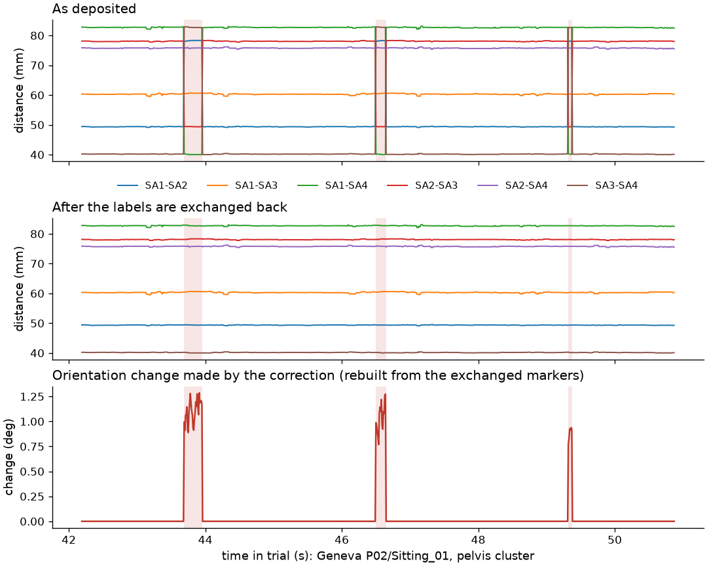

# Error 1 - Swapped marker labels (within a cluster)

[Back to the error catalogue](../../README.md#the-errors) · Module: [`e01_label_swaps.py`](../../src/imunity/errors/e01_label_swaps.py) · Known-answer test: [`tests/test_e01_label_swaps.py`](../../tests/test_e01_label_swaps.py) · What happens to the data: **fix**

## What it is

The optical reference of a segment is built from a cluster of markers (reflective balls whose 3D positions the cameras
measure). If two markers of one cluster carry each other's names, the orientation built from them is wrong, often by
close to 180°. A swap can last for the whole trial (labelled wrongly at the start), start at some frame (a marker
re-identified wrongly after it was hidden) or last a few frames. Every estimator scored against such a reference is
judged against a wrong answer there. Swaps between markers of different segments are not looked for.

## How we find it

The check reads only the markers. A rigid cluster keeps the distance between every pair of its markers.

1. **Reference table.** For each participant and session, the typical distance of every marker pair: the median over
   the trials of each trial's median distance.
2. **Pieces.** Each trial is cut into pieces where a marker goes missing and where markers jump onto each other's
   paths (from one frame to the next, assigning the markers to the positions predicted at constant velocity is
   cheaper with a permutation than with the stored labels).
3. **Candidate.** A piece's deviation is the largest difference between its own pair distances and the reference
   table. The candidate threshold is how far two correct tables differ: the static trial's deviation from the
   reference table where the participant has a static trial, otherwise the participant's median trial deviation.
4. **Confirmation.** A candidate counts as swapped only if exchanging one pair of labels brings its deviation down to
   what an ordinary correct window of the same length reaches: the upper outlier fence (upper quartile + 1.5
   interquartile ranges) of the deviations of all windows of that length in the session. The candidate threshold is
   not used here because a repaired piece is only as good as a correct trial, so half of them would fail it.
5. **Not judgeable.** A pair whose exchange changes the reference table by less than twice that fence (a cluster that
   is nearly a mirror image of itself, such as Trento's near-equilateral 20 mm triangles) is named, not counted.

Where it applies: datasets whose loader carries the raw marker trajectories of a cluster of at least three markers
(`ReferenceStream.markers`). Not checkable: references without markers (OpenSense, TUK, ULTRA-MoCap, Yanshan hip,
dfjimu, REEM-C).

## How we correct it

The labels are exchanged back and the orientation of the swapped frames is rebuilt from the corrected markers: the
markers' positions in the segment frame (median over the unswapped frames) are fitted to the corrected positions
(least squares, no reflection). A swap that lasts the whole trial takes the marker positions from another trial of
the participant.

Position in the agreed order: first. It reads only the reference and relies on no earlier correction.

## Where it occurs

Swapped stretches on the files as deposited, in the 15 datasets of the paper: **37** in total. Camargo 4, Central
Florida walking 29, Geneva 3, Hankyong 1. Looked for and not found: Darmstadt stairs, Delaware compliant terrain,
IS2B, Trento, DIODEM. Not checkable (no markers): OpenSense, TUK, ULTRA-MoCap, Yanshan hip, dfjimu, REEM-C.

## Worked example: Geneva, participant P02, sitting trial, pelvis cluster



The pelvis cluster has four markers, so six pair distances (top). In three short pieces (shaded; 27, 15 and 6 frames
at 100 Hz) the distances jump: two of the six lines exchange places with two others, which is what happens when
markers SA1 and SA3 swap names (the SA1-SA3 distance itself stays, but SA1-SA2 becomes SA3-SA2, and so on). The
pieces deviate from the session's reference table by 42.6 mm; the threshold, taken from the participant's static
trial, is 0.09 mm. With SA1 and SA3 exchanged the deviation falls to 0.18-0.33 mm, below the session's bound for
pieces of that length (0.54-0.61 mm), so each piece is confirmed. After the exchange (middle) the six lines are flat.
The bottom panel shows how much the correction changes the stored orientation: about 1° in this cluster. The check
pooled the 31 trials of the participant's session for the reference table.

## Functions

```python
import numpy as np
from imunity.datasets import load_dataset
from imunity.errors import check_for_label_swaps, remove_label_swaps, handle_label_swaps
from imunity.errors.e01_label_swaps import STATIC, SessionReference

loader = load_dataset('grouvel')
trials = [t for t in loader.trials() if t.startswith('P02/')]           # the participant's session
pelvis = {t: loader.load(t).segments.get('pelvis') for t in trials}
clusters = {t: np.stack(list(s.reference.markers.values()), axis=1) for t, s in pelvis.items() if s}
reference = SessionReference(list(clusters.values()), [c for t, c in clusters.items() if STATIC.search(t)])
rec = loader.load('P02/Sitting_01')
result = check_for_label_swaps(rec, {'pelvis': reference})
fixed = remove_label_swaps(rec, result)
report = handle_label_swaps(['grouvel'])        # whole datasets: prevalence, rows, corrected loader
```

`SessionReference(clusters, static_clusters)` takes the static trials separately (found by name, `STATIC`); without
them the threshold is the participant's typical trial deviation. The handler builds these tables itself, per
participant and session.
