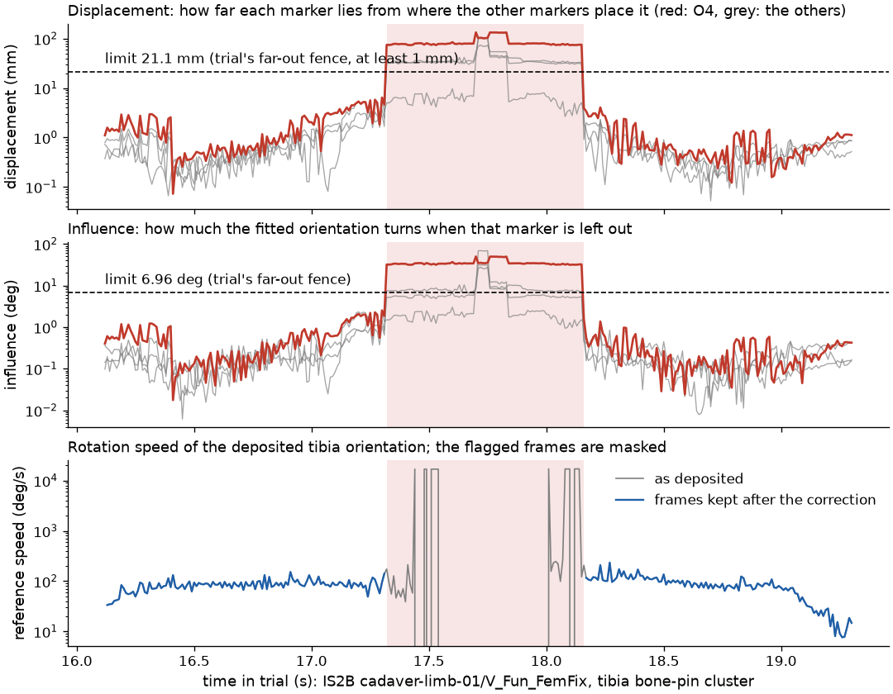

# Error 2 - Marker in the wrong place

[Back to the error catalogue](../../README.md#the-errors) · Module: [`e02_misplaced_markers.py`](../../src/imunity/errors/e02_misplaced_markers.py) · Known-answer test: [`tests/test_e02_misplaced_markers.py`](../../tests/test_e02_misplaced_markers.py) · What happens to the data: **mask** (rigid clusters) / **report** (skin clusters)

## What it is

Every marker of a cluster has a position and the right name, but one marker's position is wrong for a few frames: a
reflection or a "ghost" was taken for it, two markers merged, or the cameras triangulated it poorly. The cluster is
dented and the orientation built from it tilts or jumps, so the reference is wrong in exactly those frames. Only
transient errors are looked for (the marker returns to its place within the trial); a run that reaches the trial's
first or last frame (perhaps a marker that came loose or was glued on again) is reported, not counted.

## How we find it

The check reads only the markers, after the label swaps of error 1 are exchanged back.

1. **Shape.** The cluster's shape (the markers' positions relative to each other) is learnt from the trial's own
   frames by repeated least-squares alignment and medians.
2. **Leave one out.** In every frame with at least four markers, each marker is left out once and the shape is fitted
   to the others. Two numbers per marker and frame: its *displacement*, the distance between where it is and where
   the other markers place it (mm), and its *influence*, the angle between the orientations fitted with and without
   it (degrees). The marker to blame is the one whose leave-out fit matches the remaining markers best.
3. **Decision.** The blamed marker is misplaced if both its displacement and its influence lie above the normal range
   of the trial: the far-out outlier fence (upper quartile + 3 interquartile ranges) over all markers and frames of the
   trial. The displacement must also exceed 1 mm, the largest inter-marker distance error of current optical systems
   reported in the literature. The fence is set per trial because trials hold very different motions; it already
   contains the trial's soft-tissue movement, so skin-marker clusters are checked with the same rule.
4. One occurrence is one continuous run of frames with the same marker to blame.

Where it applies: clusters of at least four markers. Not checkable: clusters of three markers (leaving one out leaves
two, which define no orientation) and references without markers. Known limit: where the error fills much of a trial,
its fence rises and hides it; each trial's fences are therefore compared with the other trials of its session and a
trial far out of line is reported. An offset that stays constant through a trial is not seen here; it is absorbed by
the later removal of the constant mounting rotation (error 18).

## How we correct it

- **Rigid clusters** (markers on the IMU housing, bone pins, rigid bodies; `RIGID_CLUSTERS`: TUK, OpenSense,
  Hankyong, Geneva, Trento, IS2B, DIODEM): a misplaced marker can only be a reconstruction error, so every frame of a
  transient run is marked invalid (`mask_misplaced_markers`).
- **Skin clusters**: the runs are only counted; the frames stay as deposited. Most runs there are smooth skin
  deformations, the blamed marker stays within 1 mm of its own path.
- A rebuild of the orientation from the remaining markers (`remove_misplaced_markers`) exists but is not applied in
  the agreed order: it moved Camargo's flagged frames from 0.6° to 15° away from their clean neighbours (medians) and
  Darmstadt's from 1.2° to 4.0°.

Position in the agreed order: second, after the label swaps (error 1).

## Where it occurs

Affected stretches on the files as deposited, in the 15 datasets of the paper: **83,923**. Skin clusters (reported):
Camargo 22,418, Central Florida walking 27,897, Darmstadt stairs 14,214. Rigid clusters (masked): Geneva 15,542, IS2B
3,364, DIODEM 488. Not checkable (three-marker clusters or no markers): Delaware compliant terrain, Hankyong,
OpenSense, Trento, TUK, ULTRA-MoCap, Yanshan hip, dfjimu, REEM-C.

## Worked example: IS2B, cadaver limb 01, trial V_Fun_FemFix, tibia bone-pin cluster



For 39 frames (shaded) marker O4 of the tibia cluster sits up to 134 mm away from where the other three markers place
it (top, red), far above the trial's fence of 21.1 mm. Leaving O4 out turns the fitted orientation by up to 50°
(middle), above that fence of 6.96°. The other markers (grey) are also displaced inside the stretch because the
misplaced O4 distorts every fit it takes part in, but the check blames the marker whose removal leaves the best fit.
The bottom panel shows the consequence in the deposited reference: the tibia appears to rotate at more than
10,000°/s inside the stretch. As the cluster is rigid (bone pins), those frames are marked invalid (blue: frames kept).

## Functions

```python
from imunity.datasets import load_dataset
from imunity.errors import check_for_misplaced_markers, handle_misplaced_markers
from imunity.errors.e02_misplaced_markers import mask_misplaced_markers

rec = load_dataset('is2b').load('cadaver-limb-01/V_Fun_FemFix')
result = check_for_misplaced_markers(rec)
print(result.per_segment['tibia']['runs'])          # first frame, frames, marker, displacement, influence
fixed = mask_misplaced_markers(rec, result)          # rigid clusters: frames of each run marked invalid
report = handle_misplaced_markers(['is2b'])          # masks rigid readers, reports skin clusters
```
