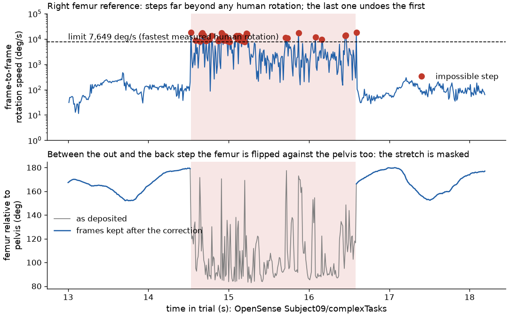

# Error 3 - Reference jumps or flips

[Back to the error catalogue](../../README.md#the-errors) · Module: [`e03_reference_jumps.py`](../../src/imunity/errors/e03_reference_jumps.py) · Known-answer test: [`tests/test_e03_reference_jumps.py`](../../tests/test_e03_reference_jumps.py) · What happens to the data: **mask**

## What it is

Single reference frames, or short stretches, in which the optical orientation jumps, often by close to 180°, because
markers were mislabelled or hidden. A body segment cannot rotate that fast and the IMU on it did not, so an estimator
scored against these frames is charged with an error the reference made.

## How we find it

The check reads only the optical references (no IMU), so it needs no synchronisation.

1. **Impossible step.** A step between two consecutive valid reference frames is impossible if the rotation between
   them divided by the time between them exceeds `MAX_SEGMENT_RATE_DPS` = 7,649°/s, the fastest rotation of a human
   body part for which a measurement was found. The angle is the geodesic angle between the two orientations, so the
   sign of the quaternion does not matter; frames already invalid are skipped and the step across a gap is measured
   over the gap's whole time.
2. **Out and back.** A real glitch or flip goes out and comes back. An out step is paired with the first later step
   that undoes it: the offset entering the stretch and the offset leaving it must agree within what the true
   orientation can move in one frame at the limit (38° at 200 Hz, 76° at 100 Hz).
3. **Confirmed against the other segments.** The stretch must also be offset against every other segment of the
   trial: the mean rotation of this segment relative to another one inside the stretch and just around it must
   differ by at least half (`OTHER_SEGMENT_SHARE`) of the out step's angle. A true flip by F shifts this joint
   rotation by about F; two unrelated glitches whose offsets happen to agree leave it in place. On 75 real stretches
   longer than 1 s, the 3 real flips shifted by 156-177° against steps of 163-179°, the 72 others by 0.4-12°.
4. A step without a partner is counted and reported as unpaired, not masked: the reference alone cannot tell which
   side of it is wrong.

Where it applies: every dataset with an optical orientation. Not checkable: references sampled below
`MIN_CHECKABLE_RATE_HZ` (7,649 / 180 = 42.5 Hz), where even a 180° step stays below the limit (DIODEM's 30 Hz
parts). Jumps smaller than the limit allows per frame are not found by this rule.

A second rule is kept in the module as a tool but is not part of the agreed order because it needs synchronised
streams: `check_for_reference_jumps` flags frames whose reference rotation speed differs from the gyroscope's by more
than 300°/s.

## How we correct it

The frames between the out and the back step of each confirmed pair are marked invalid: a single frame for a
one-frame glitch, the whole stretch for a flip. Impossible steps inside the stretch belong to it.

Position in the agreed order: after errors 1, 2 and 4. Gaps filled without a flag (error 4) are masked first, so a
fill across a gap does not count as a jump.

## Where it occurs

Impossible steps on the files as deposited, in the 15 datasets of the paper: **1,335**. Camargo 992, Central Florida
walking 3, Darmstadt stairs 4, Delaware compliant terrain 2, Geneva 18, OpenSense 70, Trento 67, ULTRA-MoCap 56, Yanshan
hip 118, dfjimu 5. Looked for and not found: Hankyong, IS2B, TUK, DIODEM (its 30 Hz parts not checkable), REEM-C.

## Worked example: OpenSense, Subject09, complex tasks, right femur



At 14.5 s the right femur's reference steps by about 179° from one frame to the next (top; frame-to-frame rotation
speed on a log scale, red dots above the dashed limit of 7,649°/s). Over the next two seconds 39 impossible steps
follow, until a last step undoes the first one. The bottom panel shows why this is a flip and not real motion: the
femur's orientation relative to the pelvis jumps away and back with it, while before and after it follows a smooth
pattern. The 206 frames between the first and the last step (about 2 s at 100 Hz) are marked invalid; blue shows the
frames kept.

## Functions

```python
from imunity.datasets import load_dataset
from imunity.errors import handle_reference_jumps
from imunity.errors.e03_reference_jumps import (check_for_impossible_reference_steps,
                                                remove_impossible_reference_steps)

rec = load_dataset('opensense').load('Subject09/complexTasks')
result = check_for_impossible_reference_steps(rec)   # per segment: steps, pairs, unpaired, frames masked
fixed = remove_impossible_reference_steps(rec)       # frames between each out-and-back pair marked invalid
report = handle_reference_jumps(['opensense'])
```
