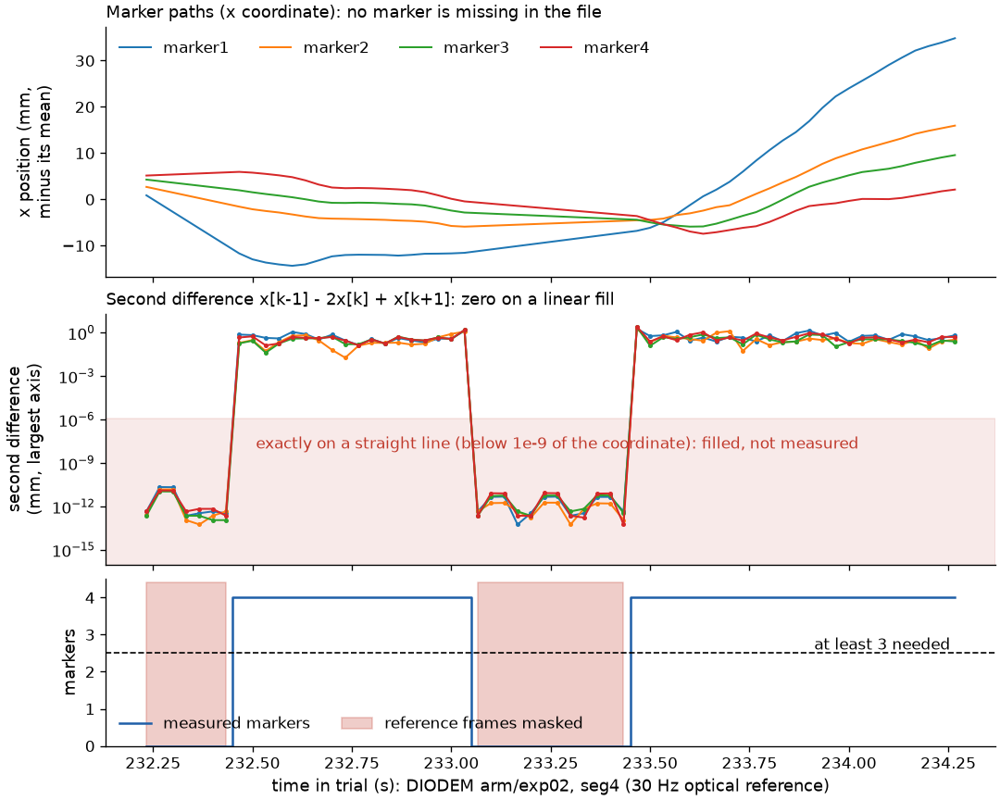

# Error 4 - Gaps filled without a flag

[Back to the error catalogue](../../README.md#the-errors) · Module: [`e04_gap_fill.py`](../../src/imunity/errors/e04_gap_fill.py) · Known-answer test: [`tests/test_e04_gap_fill.py`](../../tests/test_e04_gap_fill.py) · What happens to the data: **mask**

## What it is

A segment's orientation needs at least three measured markers of its cluster. Where fewer were seen (occlusion), no
orientation can be computed. If the deposit still carries one, the gap was filled, by the recording software or the
depositors, and nothing marks it. An estimator is then scored against an orientation that was invented, not measured.

## How we find it

The check reads only the markers.

1. **Measured marker.** Per frame, a marker counts as measured if it has a value and was not filled with a straight
   line. A linear fill leaves a second difference `x[k-1] - 2 x[k] + x[k+1]` of exactly zero on all three axes, up to
   the storage resolution of the file (at most 2 resolution steps) and numerical rounding (1e-9 of the coordinate).
   A real marker never moves on an exact line: on DIODEM the fills stay below 3e-12 m and measured markers above
   9e-7 m, so 1e-9 lies about three orders of magnitude from both. A marker held at one position (first difference
   exactly zero) is a different fingerprint and is not counted as filled here.
2. **Filled frame.** A frame whose cluster has fewer than 3 measured markers while the reference is valid.
3. One occurrence is one continuous stretch of filled frames of one segment.

Straight lines are looked for only in marker files that keep full precision (`GAP_FILL` settings per reader). In
files rounded to float32 or to 0.001 mm a straight fill is exact only to the rounding step, which quiet or smoothed
motion reaches as well, so there only visible gaps (missing markers) count and a fill goes unseen. Spline or pattern
fills leave no exact line and stay invisible in every file: a dataset without visible gaps or straight-line fills is
not checkable, not free of the error.

Where a deposit publishes its own orientations or joint angles next to the raw markers (Trento's optical
quaternions, Darmstadt's joint angles, Camargo's and Central Florida walking's OpenSim angles), the count is what a
user of that output gets: a frame is unreliable if the output has a value although fewer than 3 of the segment's
markers are visible. These outputs are compared frame by frame with the raw markers.

## How we correct it

The orientation in such a frame is not measured, so the frame is marked invalid. The mask is always built from our
reader's reference and markers, also where the count comes from a provider's output, because that output is not what
the estimators are scored against.

Position in the agreed order: after errors 1 and 2, and before error 3 (reference jumps), so a fill across a gap is
not taken for a jump.

## Where it occurs

Filled stretches on the files as deposited, in the 15 datasets of the paper: **6,999**. Camargo 1, Darmstadt stairs
4,815, Trento 1,737, DIODEM 446. Looked for and not found: Central Florida walking, Delaware compliant terrain, Geneva,
Hankyong, IS2B (in these float32 or 0.001 mm files only visible gaps count; a straight fill would go unseen). Not
checkable (no raw markers, or an encoder reference): OpenSense, TUK, ULTRA-MoCap, Yanshan hip, dfjimu, REEM-C.

## Worked example: DIODEM, trial arm/exp02, segment 4



No marker of segment 4 is missing in the file (top: x coordinates of the four markers). But in two stretches the
second difference of every marker drops from about 1 mm to about 1e-12 mm (middle, log scale): all four markers move
on exact straight lines, the fingerprint of a linear fill. The count of measured markers falls from 4 to 0 there
(bottom), below the 3 an orientation needs, while the deposit still carries a valid orientation. Those frames are
marked invalid (red shading). In this trial the segment has 97 such stretches (967 of 10,498 frames).

## Functions

```python
from imunity.datasets import load_dataset
from imunity.errors import check_for_gap_fill, remove_gap_fill, handle_gap_fill

rec = load_dataset('diodem').load('arm/exp02')
result = check_for_gap_fill(rec, resolution=0.0)    # storage step of the marker file; 0 = full precision
fixed = remove_gap_fill(rec, resolution=0.0)        # frames with fewer than 3 measured markers marked invalid
report = handle_gap_fill(['diodem'])                # uses each reader's own resolution setting
```
