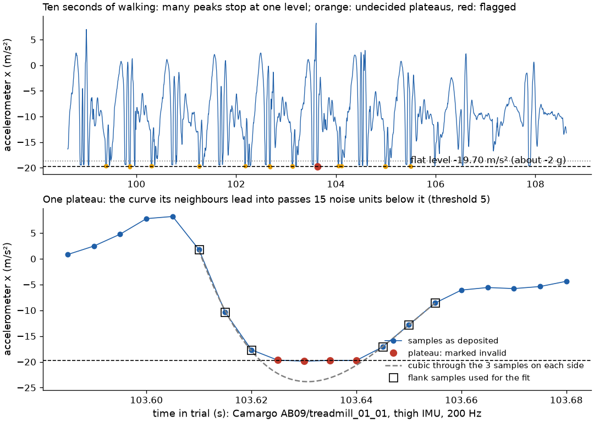

# Error 5 - Clipping

[Back to the error catalogue](../../README.md#the-errors) · Module: [`e05_clipping.py`](../../src/imunity/errors/e05_clipping.py) · Known-answer test: [`tests/test_e05_clipping.py`](../../tests/test_e05_clipping.py) · What happens to the data: **mask**

## What it is

Every sensor has a measurement range. When the true rate or acceleration goes beyond it, the stored value stays at
the limit until the signal returns: the peak is cut off. The missing part of the peak is lost, so an integrated
gyroscope under-rotates and an accelerometer reports a wrong direction of gravity during the plateau. The range is
rarely documented, so the check must find the limit without knowing it.

## How we find it

Per channel and per side (largest positive and largest negative values), without knowing the range:

1. **Noise.** The channel's own noise from its quietest stretches (the 10 % quantile of a robust second-difference
   noise over 0.5 s windows), at least the quantisation noise of coarsely stored data. Every tolerance below is a
   multiple of it, so every dataset gets its own scale.
2. **Plateaus.** The top level is the highest value two consecutive samples both reach (one spike cannot set it).
   Runs of at least 2 samples within 2 x 3 noise of that level are candidate plateaus.
3. **Fit to the neighbours.** A cubic is fitted to the 3 samples before and the 3 after the plateau and extended
   across it (a parabola cannot follow a fast rise and a slow fall). A natural peak meets the plateau. The plateau is
   *cut off* when the extended curve rises past its level by more than 5 times the noise of that comparison (sensor
   noise, the fit's own uncertainty and its misfit to the flanks, combined).
4. **Undecided.** A plateau at the edge of the trial or next to missing values (no flanks), or whose flanks the cubic
   does not follow (too few samples per peak, such as a heel strike at a low rate), is counted as undecided, not
   flagged.
5. **Further conditions**, each from what a range limit must be:
   - *in motion*: another channel of the same IMU varies during the plateau (at rest everything is flat);
   - *smallest possible range*: the level lies at least 1.9 g from zero for an accelerometer (2 g, the smallest
     common range, less 5 % sensitivity tolerance) and 125°/s for a gyroscope;
   - *not exceeded*: no peak of the same sensor in the same trial goes more than 5 % beyond the level;
   - *recurring*: another cut-off plateau of the same channel and side, in the same trial or another trial of the
     participant, lies within 6 noise of the level. A single one is reported as `single`, not flagged.
6. A cut-off plateau shorter than 1 s is clipping (this error); a longer one is a railed channel (error 7).

Pile-up of samples at the top and the median accelerometer length are reported as further evidence but not used to
decide. Exactly constant stretches in the middle of the range belong to error 7.

## How we correct it

The true value is unknown, so the samples of each clipped plateau are marked invalid (all six channels of that IMU
sample). Undecided and single plateaus are left as they are.

Position in the agreed order: after the reference errors 1-4; first of the sample defects, so a channel held at its
limit is not counted again as stuck (error 7).

## Where it occurs

Clipped plateaus on the files as deposited, in the 15 datasets of the paper: **1,061**. Camargo 1,059 (thigh IMU),
Central Florida walking 2. Looked for and not found in the other 13 datasets.

## Worked example: Camargo, participant AB09, treadmill trial 01, thigh accelerometer x



Top: ten seconds of walking. Many negative peaks of the thigh accelerometer's x axis stop at the same level,
-19.70 m/s², just above the smallest plausible range of 1.9 g (dotted). This is the fingerprint of a 2 g range. Of the
63 plateaus at that level in the trial, 55 are undecided (orange): at 200 Hz the heel-strike peaks are so sharp that a
cubic through 3 samples on each side does not follow their flanks. Five fit a natural peak, and three are confirmed
as cut off (red). Bottom: one confirmed plateau. The cubic through the flank samples (squares) passes 15 noise units
below the plateau, beyond the threshold of 5, so the signal was heading past the level when it was cut. Its 4 samples
are marked invalid; in this trial 11 samples are masked in total.

## Functions

```python
from imunity.datasets import load_dataset
from imunity.errors import check_for_cut_off_peaks, remove_cut_off_peaks, handle_clipping

rec = load_dataset('camargo').load('AB09/treadmill_01_01')
result = check_for_cut_off_peaks(rec)        # per segment: clipped and railed samples, levels, undecided plateaus
fixed = remove_cut_off_peaks(rec)            # clipped (and railed) samples marked invalid
report = handle_clipping(['camargo'])        # pools the plateau levels of each participant for the recurrence
```

`check_for_cut_off_peaks` finds railed channels (error 7) with the same rule; the handler of error 5 masks only the
clipped plateaus, the handler of error 7 the railed ones.
