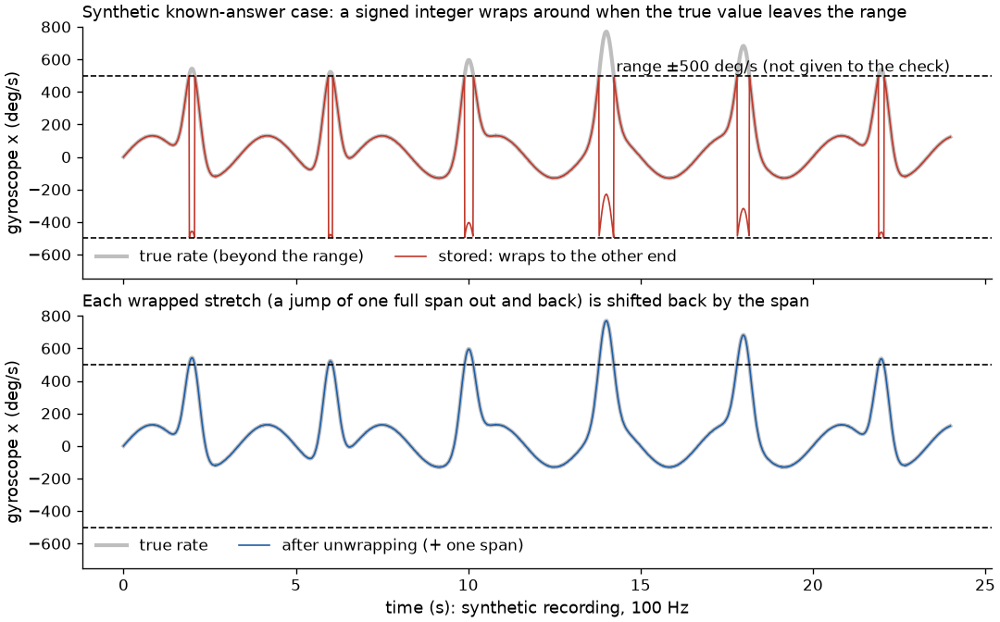

# Error 6 - Integer overflow

[Back to the error catalogue](../../README.md#the-errors) · Module: [`e06_integer_overflow.py`](../../src/imunity/errors/e06_integer_overflow.py) · Known-answer test: [`tests/test_e06_integer_overflow.py`](../../tests/test_e06_integer_overflow.py) · What happens to the data: **fix**

## What it is

A sensor stores each sample as a signed integer. When the true value passes the top of the range R, a sensor that
does not clip lets the integer wrap around to the bottom: the stored value is the true value minus the full span
S = 2R until the true value returns inside the range, where it jumps back. Integrated, such a stretch turns the
estimate the wrong way at full speed. Unlike clipping, nothing is lost: true value = stored value + S over the wrapped
stretch.

## How we find it

Per channel, without knowing the range (an exploratory rule):

1. **Noise** of the channel, as in the clipping check, so every tolerance has the data's scale.
2. **Entry and exit jumps.** One sample step between opposite signs, both beyond half of the channel's largest reach
   (the largest absolute value two consecutive samples both reach). The size of the wrap is the step minus the true
   change over one sample, estimated from the two neighbouring steps.
3. **Span.** The channel's span is twice its largest stored absolute value (a wrapped channel stores nothing beyond
   its range). A jump counts if the local curvature is at most 10 % of the span and its size agrees with the span
   within the noise of a step and 5 % of the span. An entry is paired with the first later jump of the opposite
   direction, which must agree too.
4. **The stretch stays on the other side.** Every stored sample between entry and exit has the sign opposite to the
   overflow, as it must while the true value lies between R and 2R. A natural fast reversal crosses back through
   zero and fails this.
5. **Smooth junctions.** After unwrapping, the steps at both ends are no larger than their neighbours by more than the
   noise allows, and the wrapped stretch is shorter than the stretches around it (a range is chosen so the signal
   lies inside it most of the time; without this rule the in-range samples between two wraps of a one-sided signal,
   such as gravity on an accelerometer axis, were taken for wrapped ones: 3.2 million false samples when wraps were
   injected into Delaware compliant terrain).
6. **Range.** R = span / 2 must lie at least 1.9 g or 125°/s from zero, as for clipping.
7. An entry with no exit (the trial ends, or values go missing while wrapped) is undecided and reported.

Not separable: a single sample flipped to the negative of its neighbour at the channel's peak looks like a one-sample
wrap. Several wraps in a row (true value beyond 3R) are not handled.

## How we correct it

Each wrapped stretch is unwrapped: the span is added back (or subtracted, for a wrap at the bottom). The span used is
the median of all accepted jumps of the channel, since the hardware fixes it; unwrapping is therefore exact up to the
error of that median, not bit-exact. `remove_integer_overflow(rec, mode='mask')` marks the stretches invalid instead.

Position in the agreed order: after clipping (error 5), before dead, stuck or railed channels (error 7).

## Where it occurs

Wrapped stretches on the files as deposited, in the 15 datasets of the paper: **0**. Looked for in all 15, found in
none. In tests that injected wraps into real recordings the check found 79 % of them at 2,000 Hz but only 21 % at
40-200 Hz, where a fast peak spans few samples; so "not found" is weaker at low sampling rates.

## Worked example: synthetic known-answer case

Because no dataset contains an overflow, the example uses the synthetic recording of the known-answer test
(`tests/test_e06_integer_overflow.py`, `test_unwrapping_restores_the_true_signal`): a smooth gyroscope signal with six
bursts reaching 1.3 times a range of ±500°/s that the check is not told, sampled at 100 Hz.



Top: wherever the true rate (grey, wide) goes above +500°/s, the stored value (red) jumps by one full span to the
negative end and comes back when the true rate returns into the range. Bottom: the check finds every wrapped stretch
from the jumps alone, estimates the span from them, and adds it back; the unwrapped signal (blue) lies on the true one.
The test asserts that the unwrapped signal is within 1 % of the range of the true signal everywhere, that clean data,
clipped data, single spikes, fast natural reversals and steps are not flagged, and that a wrap running to the end of
a trial is undecided.

## Functions

```python
from imunity.synthetic import make_recording
from imunity.errors import check_for_integer_overflow, remove_integer_overflow, handle_integer_overflow

rec = make_recording(duration_s=24.0, imu_rate_hz=100.0, seed=3)   # inject a wrap as in the known-answer test
result = check_for_integer_overflow(rec)          # per segment: wrapped stretches, span, undecided entries
fixed = remove_integer_overflow(rec)              # mode='unwrap' (default) or mode='mask'
report = handle_integer_overflow(['camargo'])
```
