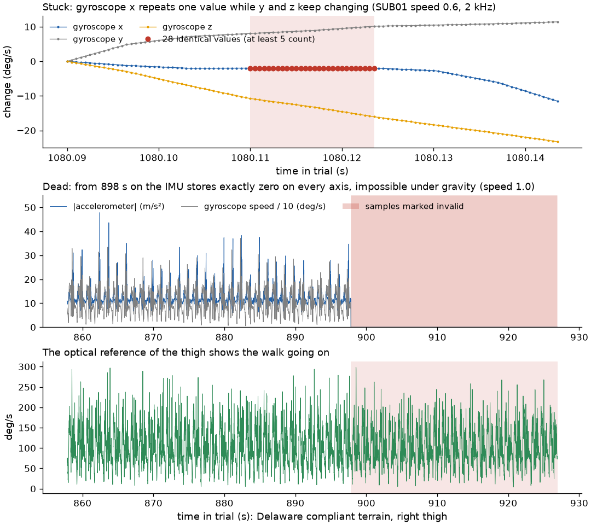

# Error 7 - Dead, stuck or railed channel

[Back to the error catalogue](../../README.md#the-errors) · Module: [`e07_dead_channels.py`](../../src/imunity/errors/e07_dead_channels.py) · Known-answer test: [`tests/test_e07_dead_channels.py`](../../tests/test_e07_dead_channels.py) · What happens to the data: **mask**

## What it is

IMU samples that carry no information about the motion: a channel that repeats exactly the same value while the
sensor moves (stuck), a sensor that stores missing values or zeros (dead), or a channel that jumped to an extreme
value and stays there (railed). An estimator that integrates such samples turns with a wrong rate or tilts towards a
wrong gravity direction for as long as they last.

## How we find it

- **Stuck channel**: a channel repeats exactly the same value for at least `MIN_RUN` = 5 samples while the sensor is
  moving. Moving means that the optical reference, or another channel of the same IMU, varies during that stretch by
  more than `N_SIGMA` = 3 times its own noise (noise from second differences over the whole trial). Time is taken as
  deposited; the synchronisation is checked later (error 12), so a large time offset makes the reference test look
  at the wrong moment.
- **Dead sensor**: missing values, and an accelerometer reading exactly zero on all three axes, which is impossible
  under gravity. These need neither the reference nor motion.
- **Railed channel**: found with the range-free rule of [error 5](05-clipping.md): a cut-off plateau of at least
  1 s, or a channel at one level for more than half of the trial while another channel of the IMU moves, at least
  1.9 g or 125°/s from zero.
- **Held samples** (consecutive samples identical on all six channels, channels that never change) are measured as a
  tool but not counted here.

Not applied to RepoIMU (`NO_DEAD_STAGE`): its repeated whole samples count as a sampling-rate error (error 11).

## How we correct it

The true value is unknown, so the affected samples are marked invalid (`ImuStream.valid`, all channels of that IMU
sample). Later checks skip invalid samples instead of using an invented value.

Position in the agreed order: after clipping (error 5) and integer overflow (error 6), so a channel held at its range
limit is counted once, as clipping.

## Where it occurs

Affected stretches (stuck runs plus railed channels) on the files as deposited, in the 15 datasets of the paper:
**8,355**. Camargo 10, Central Florida walking 58, Darmstadt stairs 3,066, Delaware compliant terrain 4,462, Geneva 2,
OpenSense 1, ULTRA-MoCap 623, Yanshan hip 123, dfjimu 9, DIODEM 1. Looked for and not found: Hankyong, IS2B, Trento,
TUK, REEM-C.

## Worked example: Delaware compliant terrain, participant SUB01, right thigh IMU



Top, stuck (walking at 0.6 m/s, sampled at 2 kHz): the gyroscope's x channel repeats one value for 28 samples (14 ms,
red) while its y and z channels keep changing (each curve is shown relative to its first sample). The other channels
move by far more than three times their noise, so the run is flagged. Middle and bottom, dead (walking at 1.0 m/s):
from 898 s on, the IMU stores exactly zero on every channel for 58,194 samples (29 s), while the optical reference of
the thigh shows the walk going on (bottom). An accelerometer reading exactly zero is impossible under gravity, so all
these samples are marked invalid (red shading). Together with its stuck runs, 59,838 samples of this IMU are masked in
that trial.

## Functions

```python
from imunity.datasets import load_dataset
from imunity.errors import check_for_dead_channels, remove_dead_channels, handle_dead_channels
from imunity.errors.e07_dead_channels import stuck_samples

rec = load_dataset('compliant_terrain').load('SUB01/speed0p6')
result = check_for_dead_channels(rec)             # per segment: samples, stuck stretches, missing, zero accelerometer
bad, stretches = stuck_samples(rec['thigh_r'])    # the stuck stretches of one IMU, with the rule that fired
fixed = remove_dead_channels(rec)                 # stuck, missing and all-zero samples marked invalid
report = handle_dead_channels(['compliant_terrain'])   # also masks railed channels (error 5's rule)
```
