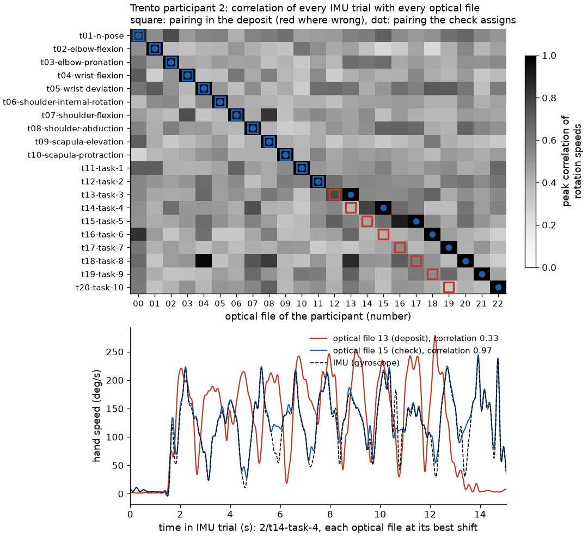

# Error 8 - Wrong trial pairing

[Back to the error catalogue](../../README.md#the-errors) · Module: [`e08_trial_pairing.py`](../../src/imunity/errors/e08_trial_pairing.py) · Known-answer test: [`tests/test_e08_trial_pairing.py`](../../tests/test_e08_trial_pairing.py) · What happens to the data: **fix**

## What it is

An IMU recording is paired with the optical recording of another trial. Each stream is real motion, so joint angles
stay plausible and nothing looks broken, but IMU and reference do not show the same movement: an estimator is scored
against another trial. In Trento, the deposit pairs the k-th IMU trial with the k-th optical file, although aborted
and repeated optical takes shift the numbering.

## How we find it

This is the Trento reader's own pairing repair, applied to every dataset.

1. **Score.** Every candidate pair (IMU trial, optical recording) is scored by the peak normalised
   cross-correlation of the gyroscope's rotation speed with the reference's rotation speed over the full range of
   shifts (at least half of the shorter series overlapping), both low-passed at 5 Hz without phase shift, on a grid
   at the reference's rate. Rotation speeds do not depend on how the IMU is mounted. A candidate's score is its best
   segment's peak.
2. **Assignment.** The IMU trials are assigned to optical recordings so that the total gain (score - 0.5) is largest,
   each optical recording used at most once, and no pairing below 0.5 (such a trial stays unpaired).
   - Default (`NEIGHBOURS` = 5): per participant, candidates lie within 5 positions of the trial's own position, and
     the assignment keeps the chronological order of both lists.
   - `all_trials=True`: every optical recording of the dataset is a candidate for every IMU trial, with no assumption
     about names, order or participants; the assignment is then the best one-to-one matching (Hungarian method) with
     the same gain and floor.
3. A trial is wrongly paired if the assignment gives it another optical recording than the declared one, or none. A
   static recording without a match is not counted: it has no motion to match.

## How we correct it

Each trial is paired with its assigned optical recording; unpaired trials have no reference. Only Trento is
corrected: from this error on it is read with its repaired pairing (reader `bonfiglio` instead of
`bonfiglio_deposited`; for the authors' processed files, `bonfiglio_final` instead of `bonfiglio_final_deposited`). The
other wrongly paired trials (Darmstadt, ULTRA-MoCap) are reported only. Geneva's are a consequence of its mis-assembled
streams (error 10) and vanish on the streams rebuilt from its raw logs, on which its pairing is checked in the agreed
order.

Position in the agreed order: first of the assignment errors, after the reference errors (1-4) and sample defects
(5-7): a time offset or mounting measured against the wrong recording would mean nothing.

## Where it occurs

Wrongly paired trials in the 15 datasets of the paper (on the files as deposited; Geneva on its rebuilt streams):
**89**. Darmstadt stairs 1, Trento 75, ULTRA-MoCap 13. Looked for and not found in the other 12 datasets.

## Worked example: Trento, participant 2



Top: the peak correlation of the rotation speeds of each of the participant's 20 IMU trials (rows) with each of its 23
optical files (columns); dark means similar motion. Squares mark the deposit's pairing, dots the check's assignment.
Up to trial 12 the two agree on the diagonal. From trial 13 on the deposit keeps pairing trial k with file k-1 (red
squares on light cells), while the best match moves one, then two, then three files further to the right: three
optical takes in between were aborted or repeated. Bottom: trial 14 (task 4). The hand's gyroscope speed (dashed) follows optical file 15 (the check's
choice, correlation 0.97) and has nothing in common with file 13 (the deposit's pairing, correlation 0.33). Trials 13
to 20 of this participant are re-paired.

## Functions

```python
from imunity.datasets import load_dataset
from imunity.errors import handle_trial_pairing

report = handle_trial_pairing(['bonfiglio'])          # Trento as deposited: k-th IMU trial with k-th optical file
print(report.rows[['trial', 'status', 'declared', 'assigned', 'peak', 'declared_score']])
fixed = report.corrected('bonfiglio')                 # the reader with the repaired pairing
rec = load_dataset('bonfiglio').load('2/t14-task-4')  # or read the repaired pairing directly
```

There is no single-recording `check_for_` function: pairing compares recordings with each other. The building blocks
`imu_speeds`, `reference_speeds`, `score`, `assign_in_order` and `assign_any_order` in the module work on any loader.
