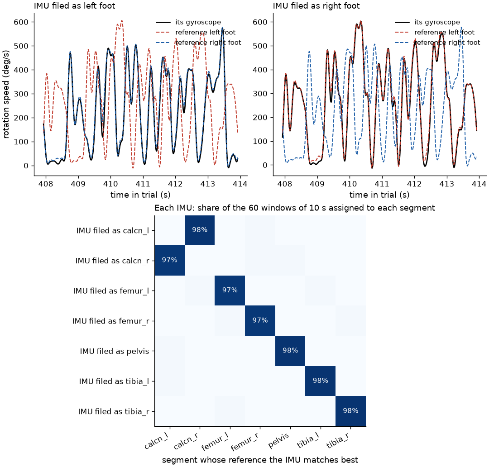

# Error 9 - IMU on the wrong segment

[Back to the error catalogue](../../README.md#the-errors) · Module: [`e09_segment_assignment.py`](../../src/imunity/errors/e09_segment_assignment.py) · Known-answer test: [`tests/test_e09_segment_assignment.py`](../../tests/test_e09_segment_assignment.py) · What happens to the data: **fix**

## What it is

The deposit files an IMU stream under a segment it was not mounted on: left and right exchanged, or two neighbouring
segments. Each stream is real body motion, so nothing looks broken; only the comparison with each segment's reference
shows it. A joint angle estimated from the exchanged streams describes another joint.

## How we find it

The assignment is checked before the time offset, gyroscope offset and mounting are corrected, so the check is built
to be insensitive to them.

1. **Common time offset without the assignment.** All IMUs are assumed to share one clock. The mean rotation speed of
   all IMUs is cross-correlated with the mean rotation speed of all reference segments. Exchanging IMUs only reorders
   the terms of these means, so this offset does not depend on the assignment. A drifting clock is followed by
   refining the lag in each window within ±0.25 s.
2. **Assignment in windows.** After shifting by the common lag, the trial is cut into windows of 10 s. In each
   window every IMU is scored against every segment's simulated gyroscope (the rotation rate computed from the
   reference, low-passed at 5 Hz) with two scores:
   - *speed*: correlation of the rotation speeds (blind to the mounting rotation);
   - *fitted*: both three-axis rates minus their means (removes a constant gyroscope offset), the best constant
     rotation between them, score = share of the gyroscope's variance it explains.
   The best one-to-one assignment of IMUs to segments in a window is that window's vote.
3. **Decision.** An IMU is on the wrong segment if more than half of its windows assign it to one other segment,
   correctly placed if more than half assign it to its declared segment, undecided otherwise. There is no score
   threshold. The two scores are decided separately; where they disagree, the IMU is undecided.
4. **Individual offsets.** Each IMU's own offset against its assigned segment is estimated (within ±1 s of the common
   lag) and step 2 is repeated with these offsets; an IMU whose decision changes is undecided.

An undecided IMU keeps its declared segment. Known limits: two segments that move alike (both legs in a squat, pelvis
and trunk in walking) cannot be told apart; windows at rest vote at random. All parameters are exploratory defaults.

## How we correct it

Each segment is given the IMU stream the check assigned to it, if the detected IMUs exchange their segments among
themselves (a permutation); otherwise nothing is changed.

Position in the agreed order: after the trial pairing (error 8), before the mis-assembled streams (error 10) and all
timing errors (11-14).

## Where it occurs

IMU streams on the wrong segment in the 15 datasets of the paper: **24**. Geneva 7, Hankyong 2, OpenSense 2, Trento 2,
ULTRA-MoCap 9, Yanshan hip 2. Looked for and not found in the other 9 datasets. Trento is counted after its re-pairing
(error 8); on its deposited pairing the count is 11.

## Worked example: OpenSense, Subject09, complex tasks, the two foot IMUs



Top: six seconds of walking. The gyroscope filed as the left foot (black, left panel) follows the right foot's
reference (blue dashed), not the left foot's (red dashed), and the gyroscope filed as the right foot (right panel)
follows the left foot's reference. Bottom: for each IMU, the share of the 60 windows of 10 s in which the window's
best assignment puts it on each segment (fitted score). The two foot IMUs land on each other's segment in 98 % and 97 %
of the windows; every other IMU stays on its own segment. The common offset is 0 ms with a peak correlation of 0.98.
The correction gives `calcn_l_imu` the stream filed under `calcn_r_imu` and vice versa.

## Functions

```python
from imunity.datasets import load_dataset
from imunity.errors import check_for_segment_assignment, remove_segment_assignment, handle_segment_assignment

rec = load_dataset('opensense').load('Subject09/complexTasks')
result = check_for_segment_assignment(rec)          # per IMU: belongs_to, votes_speed, votes_fitted, undecided
fixed = remove_segment_assignment(rec, result)      # streams exchanged where the detected IMUs form a permutation
print(fixed.corrections[-1].description)
report = handle_segment_assignment(['opensense'])
```
