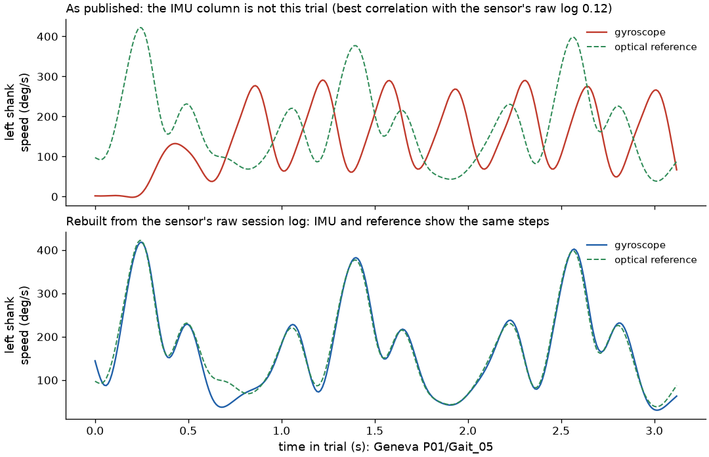

# Error 10 - Mis-assembled streams

[Back to the error catalogue](../../README.md#the-errors) · Module: [`e10_mis_assembled_streams.py`](../../src/imunity/errors/e10_mis_assembled_streams.py) · Known-answer test: [`tests/test_e10_mis_assembled_streams.py`](../../tests/test_e10_mis_assembled_streams.py) · What happens to the data: **fix**

## What it is

The depositors cut and joined the sensor streams wrongly, so a published trial file carries IMU data from another
moment of the session, a mixture, or streams that are shifted against each other. Each column is real sensor data,
so nothing looks broken in the file itself. Errors found later, such as a stretched time axis (error 11) or a wrong
pairing (error 8), can be consequences of it.

## How we find it

There is no general rule: it needs what the files should contain.

- **Geneva gait** keeps raw 256 Hz session logs (`.BIN`) that hold every sensor's whole session. The download
  rebuilds every trial's IMU streams from them (`datasets/grouvel_raw.py`, table `match.csv`). For every sensor and
  trial the rebuild stores `deposit_corr`, the best correlation of the published gyroscope (3 axes) with the same
  sensor's raw gyroscope over shifts of ±1.5 s around the trial's place in the session. A clean shifted copy gives
  about 1. A sensor-trial below `CLEAN_COPY` = 0.99 is mis-assembled; trials the rebuild could not place are
  undecided.
- **Trento**: the authors' processed files (`B_dotComplete`, read by `bonfiglio_final_deposited`) cut each sensor's
  export by row index to the shortest of the five, ignoring the sensors' recorded start skew of 2-16 samples. The
  count below is the number of sensor streams whose first time stamp (`SampleTimeFine`) lies at least one sample after
  the earliest sensor of its trial. This count is not produced by `handle_mis_assembled_streams`, which checks Geneva
  only and reports Trento as not checked.
- Every other dataset is not checked (no general rule).

## How we correct it

Geneva is read from the streams rebuilt from its raw logs (reader `grouvel_raw`). In the agreed order this reader is
used already from the trial-pairing check (error 8) on, because the pairing cannot be judged on the mis-assembled
files; the correction here only matters for a report on the deposited files. Trento's processed files are not
repaired; the corrected pipeline reads Trento from its raw files (reader `bonfiglio`).

Position in the agreed order: after errors 8 and 9, before the timing errors.

## Where it occurs

Mis-assembled IMU streams in the 15 datasets of the paper: **3,293**. Geneva 2,118 (of 2,218 sensor-trials placed in the
raw logs), Trento 1,175 (of the 1,500 streams of the 15 participants on a shared clock; participant 9, whose sensors
run on separate clocks, is not checked). Not looked for in the other 13 datasets.

## Worked example: Geneva, participant P01, gait trial 05, left shank



Top: the published IMU column of the left shank (red) against the optical reference of the same trial (green
dashed): the steps do not line up, and the best correlation of this column with the sensor's own raw log, at any shift
within ±1.5 s of the trial's place in the session, is only 0.12. Bottom: the same sensor rebuilt from its raw session
log at the trial's place: its rotation speed (blue) follows the reference step by step.

## Functions

```python
from imunity.datasets import load_dataset
from imunity.errors import handle_mis_assembled_streams

report = handle_mis_assembled_streams(['grouvel'])     # one row per sensor-trial, estimate = deposit_corr
match = load_dataset('grouvel_raw').match              # the rebuild's table: deposit_corr, deposit_shift_s, ...
deposited = load_dataset('grouvel').load('P01/Gait_05')
rebuilt = load_dataset('grouvel_raw').load('P01/Gait_05')   # the corrected streams
```
