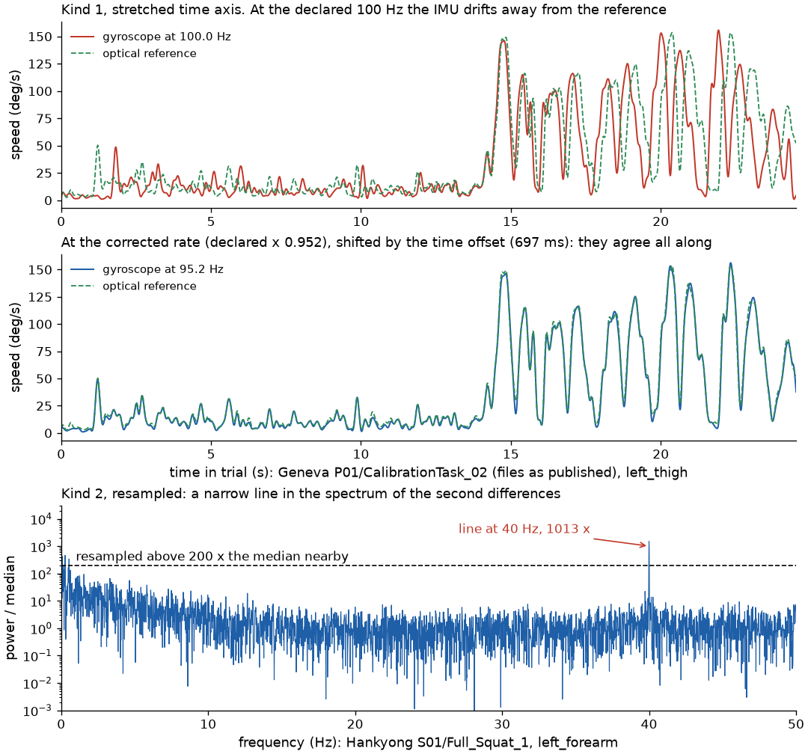

# Error 11 - Sampling rate not as declared

[Back to the error catalogue](../../README.md#the-errors) · Module: [`e11_sampling_rate.py`](../../src/imunity/errors/e11_sampling_rate.py) · Known-answer test: [`tests/test_e11_sampling_rate.py`](../../tests/test_e11_sampling_rate.py) · What happens to the data: **fix** (stretched time axis) / **report** (resampled)

## What it is

Two different things go wrong, and they need different checks.

- **Kind 1, stretched time axis**: the samples are read at the declared rate but were taken at another one, so every
  motion appears too fast or too slow by one factor f = true rate / declared rate. An estimator integrating the
  gyroscope at the wrong rate turns by the wrong angle, and IMU and reference drift apart in time.
- **Kind 2, resampled**: the time axis is right, but the samples were computed from samples at another rate, by
  repeating samples or interpolating. The stream carries less, or other, information than its rate suggests.

## How we find it

**Kind 1** (`check_for_time_scale`). The rotation speed of the gyroscope and of the reference (independent of the
mounting and of sign errors) are cross-correlated for every factor of a logarithmic grid from 1/16 to 16, the IMU time
axis divided by the factor and the best shift searched within ±10 s; coarse to fine, on windows that double until the
whole recording is used. Decision (default `method='rank-blocks'`, the same rule as for the time offset): ranks in
every correlation; a segment's factor is trusted if it is not at the edge of the grid and, with the IMU time axis
divided by it, the offsets of 5 time blocks lie on a straight line within half a reference frame. The segment
deviates if the factor is more than 2 % from 1 and at the declared rate the 5 blocks do not agree on one offset. The
recording is detected if most trusted segments deviate; its factor is the median over trusted segments. Limit: IMU
against reference measures only the ratio of the two time scales, not which stream is wrong.

**Kind 2** (`check_for_effective_rate`, needs no reference). Per IMU, on the six channels together:

- `hold_fraction`: share of samples equal to the previous one on all six channels (repeating samples from a rate r0
  leaves 1 - r0/r of them);
- `linear_fraction`: share of samples whose second difference is zero (linear interpolation from r0 < r/2 leaves
  about 1 - 2 r0/r of them; a real sensor with noise almost none);
- `line_ratio`: the strongest narrow line in the spectrum of the absolute second difference above 10 Hz, as its
  height over the median within ±1 Hz. Interpolation puts the knots of the original grid at a fixed pattern, so the
  second differences repeat with its period. Without a pattern the highest bin lies 10-20 above the median; a
  pattern gives 10³-10⁵. Decided only on recordings of about 12.5 s or more.
- `top_band_ratio`: gyroscope power in the top fifth below the Nyquist frequency over the power at 30-50 % of it;
  band-limited upsampling leaves that band numerically empty (below 1e-6).

Two outcomes, reported separately: *resampled* (`line_ratio` >= 200; clean datasets reach at most about 120) and
*below declared* (`hold_fraction` >= 0.05, `linear_fraction` >= 0.2, or `top_band_ratio` < 1e-6).

## How we correct it

Kind 1: the IMU rate becomes the declared rate times f (`remove_time_scale`); no sample is changed, cut or
resampled. Kind 2 is reported, not corrected: the timing is right, the stream only carries less information.

Position in the agreed order: first of the timing errors, after errors 1-10. A gross factor makes the offset and
drift checks (errors 12, 13) undecided, so it is corrected before them.

## Where it occurs

IMU streams with a rate not as declared, in the 15 datasets of the paper: **4,087**. Camargo 1, Central Florida walking
1, Delaware compliant terrain 24, Geneva 212 (stretched; on its published files, as a consequence of the
mis-assembled streams of error 10), Hankyong 3,840 (resampled), IS2B 3, ULTRA-MoCap 5, Yanshan hip 1. Looked for and not
found: Darmstadt stairs, OpenSense, Trento, TUK, dfjimu, DIODEM, REEM-C.

## Worked example: Geneva (stretched) and Hankyong (resampled)



Top two panels, kind 1 (Geneva, participant P01, calibration task 02, left thigh, files as published): at the
declared 100 Hz the gyroscope's speed (red) matches the reference (green dashed) at the start of the motion and falls
further and further behind it. The check finds a factor of 0.952 (median over 7 of the 8 IMUs whose blocks agree); at
95.2 Hz, and shifted by the constant time offset that error 12 then removes (697 ms), the two curves agree from start
to end. Bottom, kind 2 (Hankyong, participant S01, full squat 1, left forearm): the spectrum of the second differences
shows one narrow line at 40 Hz, 1,013 times higher than the median around it, far above the threshold of 200: the
stream was interpolated from another rate. It is reported, not changed.

## Functions

```python
from imunity.datasets import load_dataset
from imunity.errors import (check_for_time_scale, remove_time_scale, check_for_effective_rate,
                            handle_sampling_rate)

rec = load_dataset('grouvel').load('P01/CalibrationTask_02')
result = check_for_time_scale(rec)                   # result.estimate: the factor f
fixed = remove_time_scale(rec, result)               # IMU rate = declared rate x f
resampled = check_for_effective_rate(load_dataset('fullbody17').load('S01/Full_Squat_1'))
report = handle_sampling_rate(['grouvel', 'fullbody17'])
```
