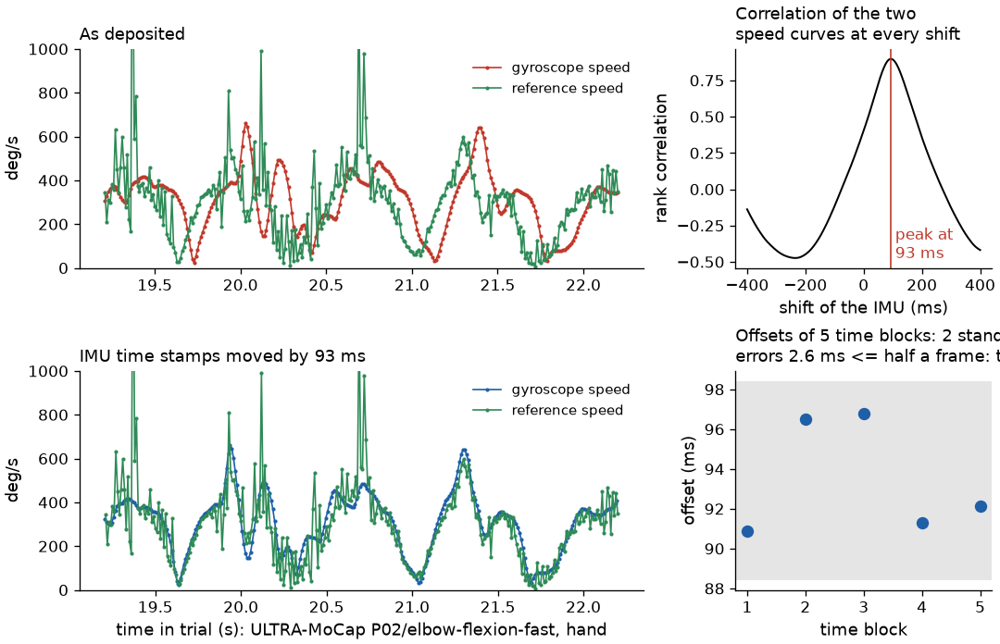

# Error 12 - Time offset between IMU and reference

[Back to the error catalogue](../../README.md#the-errors) · Module: [`e12_time_offset.py`](../../src/imunity/errors/e12_time_offset.py) · Known-answer test: [`tests/test_e12_time_offset.py`](../../tests/test_e12_time_offset.py) · What happens to the data: **fix**

## What it is

The IMU and the optical system run on different clocks. If the deposit pairs IMU sample k with the reference frame of
the same time stamp, but the clocks were started at different moments, every IMU sample is compared with the
reference of another moment. In fast motion even a few milliseconds turn into degrees of apparent estimation error.

## How we find it

1. **Simulated gyroscope.** The reference orientation is turned into an angular rate: the rotation between two
   consecutive frames divided by the frame period. This is what a perfect gyroscope on the segment would measure.
2. **Speeds.** The magnitude of both the simulated and the measured gyroscope. It does not depend on how the IMU is
   mounted or on sign errors of its axes, so the check works before those are corrected.
3. **Ranked cross-correlation.** Each speed curve is replaced by its ranks, so a single extreme value (a corrupted
   sample, an impossible reference step) counts no more than the largest true value. The curves are slid against
   each other within ±10 s; the shift with the highest correlation is the offset, refined below the grid step by a
   parabola through the peak.
4. **Block agreement.** The recording is cut into 5 equal time blocks and the offset is estimated again in each
   block, within ±1.5 s of the whole-recording offset. A segment is trusted if at least 3 blocks give an estimate,
   twice the standard error of the block offsets is at most the tolerance (half a reference frame), their median lies
   within the tolerance of the whole-recording offset, and the offset is not at the edge of the search window. There
   is no limit on the correlation height. The offset counts as detected if it exceeds the tolerance.
5. All segments of one recording share the IMU clock, so the recording's offset is the median over the trusted
   segments; the spread between segments is reported as a plausibility check.

Why ranks and blocks: with the former rule (Pearson correlation, trusted from a peak of 0.9) one corrupted sample per
segment took most segments below 0.9, the limit rejected good offsets in slow motion, and wrong peaks were trusted.
The former rule is kept as `method='peak'`.

Known limits: on periodic motion the correlation also peaks one stride away; a wrong peak preferred in every block is
not caught. A recording whose clock drifts (error 13) has no single offset and stays undecided unless the drift is
small. Recordings too short for 5 informative blocks stay undecided.

## How we correct it

The IMU time stamps are moved by the offset (`ImuStream.start_s`); no sample is changed, cut or resampled. Sign
convention: `offset_s > 0` means the IMU time stamps are late. Trento's participant 9, whose sensors run on separate
clocks, gets one offset per IMU (`remove_sensor_offsets`). `validate_offset_correction` checks the result without the
cross-correlation: over 1 s windows it compares how far the integrated gyroscope and the reference say the segment
turned, before and after the shift.

Position in the agreed order: after the stretched time axis (error 11), before the clock drift (error 13).

## Where it occurs

Trials with a time offset in the 15 datasets of the paper: **1,095**, in every dataset. Camargo 65, Central Florida
walking 124, Darmstadt stairs 287, Delaware compliant terrain 6, Geneva 13, Hankyong 29, IS2B 41, OpenSense 10, Trento
311, TUK 41, ULTRA-MoCap 141, Yanshan hip 2, dfjimu 15, DIODEM 9, REEM-C 1. Trento is counted after its re-pairing
(error 8); on its deposited pairing the count is 243.

## Worked example: ULTRA-MoCap, participant P02, fast elbow flexion, hand



Left: three seconds of the hand's gyroscope speed against its reference speed (the spiky green curve is the
reference differentiated frame by frame; the check uses ranks, so the spikes do not dominate). As deposited (top) the
gyroscope's peaks come later than the reference's; moved by 93 ms (bottom) they coincide. Top right: the rank
correlation of the two curves over shifts of ±400 ms peaks at 93 ms. Bottom right: the offsets estimated separately
in the 5 time blocks lie between 91 and 97 ms; twice their standard error is below the tolerance of 5 ms (half a frame
at 100 Hz), so the hand is trusted. The hand is the only one of the trial's three segments whose blocks agree, so the
trial's offset is its 93 ms.

## Functions

```python
from imunity.datasets import load_dataset
from imunity.errors import check_for_synchronisation_offset, remove_synchronisation_offset, handle_time_offset
from imunity.errors.e12_time_offset import validate_offset_correction

rec = load_dataset('ultramocap').load('P02/elbow-flexion-fast')
result = check_for_synchronisation_offset(rec)       # result.estimate in ms; per segment the LagEstimate
fixed = remove_synchronisation_offset(rec, result)   # IMU start_s moved; no sample changed
print(validate_offset_correction(rec, fixed))        # integrated gyroscope vs reference, before and after
report = handle_time_offset(['ultramocap'])
```
