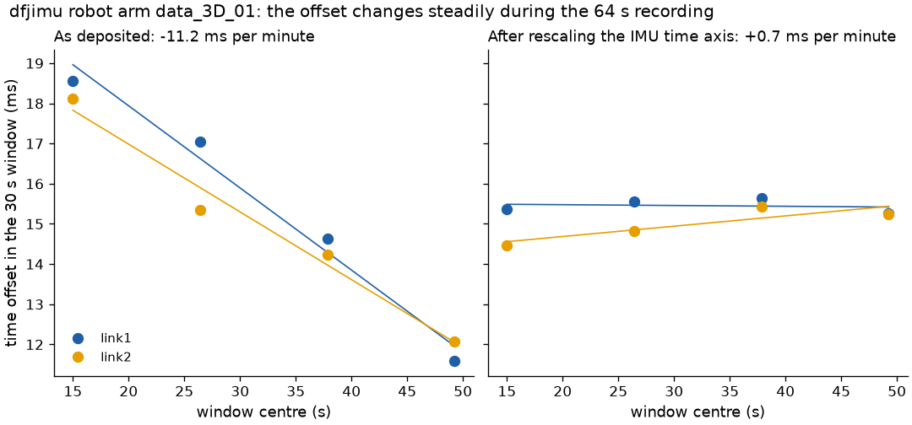

# Error 13 - Clock drift between IMU and reference

[Back to the error catalogue](../../README.md#the-errors) · Module: [`e13_clock_drift.py`](../../src/imunity/errors/e13_clock_drift.py) · Known-answer test: [`tests/test_e13_clock_drift.py`](../../tests/test_e13_clock_drift.py) · What happens to the data: **fix**

## What it is

The IMU clock and the optical clock run at slightly different speeds, so the time offset between them (error 12) is
not constant but grows during the recording. 100 ppm (parts per million) means 0.1 ms more offset per second, 6 ms per
minute. A single offset then fits only one moment of the trial; the rest stays misaligned. Drift is reported per
minute (and in ppm), so trials of different length can be compared.

## How we find it

1. The time both streams cover is cut into windows of 30 s that overlap by at least 50 %, spread evenly from the
   beginning to the end.
2. In every window the time offset is estimated exactly as the time-offset check does (ranked speed curves, search
   window capped at a third of the window). A window counts if the offsets of 5 equal blocks of it lie on a straight
   line within half a reference frame (twice the standard error of their residuals around the line) and the offset
   is not at the search edge. A line, not one constant, because the offset changes inside the window by the drift
   itself. The former rule, a correlation peak of at least 0.9, is kept as `method='peak'`.
3. A straight line offset(t) = a + d t is fitted through the counted windows of one segment (least squares, each
   window weighted equally). The slope d is the segment's drift, with its standard error.
4. All segments of one recording share the IMU clock, so the recording's drift is the median over the segments with
   at least three counted windows.
5. **Decision** (exploratory): the drift is detected if it differs from zero by more than two standard errors and
   adds up to more than half a reference frame over the recording. Recordings shorter than 60 s are undecided.

The constant part (the line's level) is the time offset of error 12 and is not reported here.

## How we correct it

The IMU time stamps are rescaled about the middle of the recording, t -> t - d (t - t_mid): a new start time and a new
sampling rate (rate / (1 - d)); no sample is changed. The offset at the middle is left as it is, so the constant offset
stays for its own correction.

Position in the agreed order: after the time offset (error 12), before the IMUs' own time scales (error 14).

## Where it occurs

Trials with clock drift in the 15 datasets of the paper: **210**. Camargo 14, Central Florida walking 14, Hankyong 149,
IS2B 15, OpenSense 1, dfjimu 14, REEM-C 3. Looked for and not found: Delaware compliant terrain, TUK, Yanshan hip,
DIODEM. Not checkable (no trial of at least 60 s): Darmstadt stairs, Geneva, Trento, ULTRA-MoCap.

## Worked example: dfjimu robot arm, trial data_3D_01



Each dot is the offset between IMU and reference in one 30 s window (centre on the x axis), for the robot arm's two
links; the lines are the fitted straight lines. As deposited (left) the offset falls from about 18.5 ms to 12 ms over
the 64 s recording: -11.2 ± 1.2 ms per minute (-187 ppm), more than two standard errors from zero and more than half
a frame (10 ms at 50 Hz) over the recording, so it is detected. After rescaling the IMU time axis about the middle of
the recording (right), the remaining slope is +0.7 ± 0.55 ms per minute, which is not detected; the constant offset of
about 15 ms stays for error 12.

## Functions

```python
from imunity.datasets import load_dataset
from imunity.errors import check_for_clock_drift, remove_clock_drift, handle_clock_drift

rec = load_dataset('dfjimu').load('data_3D_01')
result = check_for_clock_drift(rec)                # result.estimate in ms per minute; windows per segment
fixed = remove_clock_drift(rec, result)            # IMU time rescaled about mid-recording
print(check_for_clock_drift(fixed))
report = handle_clock_drift(['dfjimu'])
```
