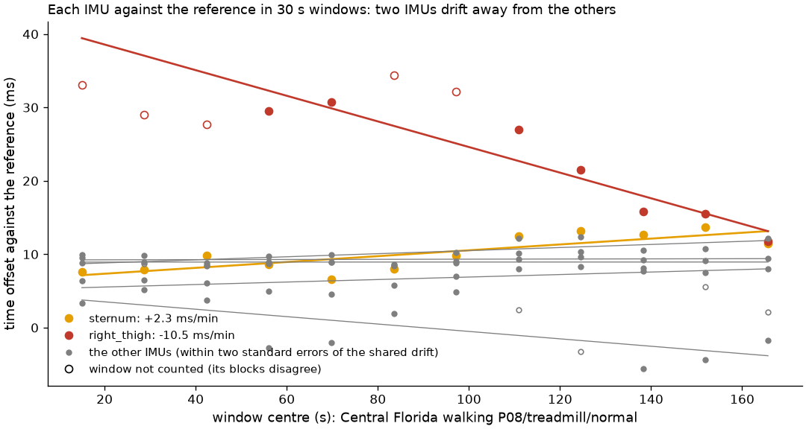

# Error 14 - IMUs of one trial on different time scales

[Back to the error catalogue](../../README.md#the-errors) · Module: [`e14_time_scales.py`](../../src/imunity/errors/e14_time_scales.py) · Known-answer test: [`tests/test_e14_time_scales.py`](../../tests/test_e14_time_scales.py) · What happens to the data: **fix**

## What it is

Each IMU runs at a slightly different true sampling rate, so the IMUs of one recording drift apart during it. Unlike
the clock drift against the reference (error 13), which all IMUs share and which cancels in a relative orientation,
this shifts the two IMUs of a joint against each other, so the joint angle is estimated from samples of different
moments.

## How we find it

1. For every IMU, its drift against the reference from the windowed offsets of the clock-drift check (30 s windows,
   at least 50 % overlap, least-squares line). Its standard error comes from every second window only, so the windows
   used do not overlap and their offsets are closer to independent (with all windows the standard error was too
   small: 74 % of TUK trials then differed "significantly" at 0.24 ms per minute). At least three such windows.
2. The drift all IMUs share is the median over the IMUs (that is error 13). Each IMU's own deviation from that median
   is this error.
3. **Threshold**: an IMU deviates if its deviation exceeds two standard errors (of the IMU and of the median combined)
   and adds up over the recording to more than half a reference frame. Recordings shorter than 60 s, or with fewer
   than two IMUs with a drift, are undecided.

## How we correct it

The time of each deviating IMU is stretched by its own deviation about the middle of the recording, as the clock drift
correction does but per IMU: t -> t - e (t - t_mid), a new start time and sampling rate, no sample changed. With only
two IMUs both get half their difference, since which one is off cannot be told.

Position in the agreed order: after the clock drift (error 13), last of the timing errors.

## Where it occurs

IMU streams with their own time scale in the 15 datasets of the paper: **198**. Central Florida walking 46, Delaware
compliant terrain 1, Hankyong 144, OpenSense 4, Yanshan hip 3. Looked for and not found: Camargo, IS2B, TUK, dfjimu,
DIODEM, REEM-C. Not checkable (no trial of at least 60 s): Darmstadt stairs, Geneva, Trento, ULTRA-MoCap.

## Worked example: Central Florida walking, participant P08, treadmill at normal speed



Each dot is one IMU's offset against the reference in one 30 s window; lines are least-squares fits through the
counted windows (filled dots; hollow dots are windows whose 5 blocks disagree). The drift the IMUs share is
+0.07 ms per minute. Six IMUs (grey) stay within two standard errors of it. The right thigh's offset falls by about
25 ms over the three minutes (-10.5 ms per minute, red) and the sternum's rises (+2.3 ms per minute, orange): both are
detected. The correction rescales the right thigh's time by +10.5 ms per minute and the sternum's by -2.3 ms per minute
about the middle of the recording (90 s), so all eight IMUs share the time scale of the others.

## Functions

```python
from imunity.datasets import load_dataset
from imunity.errors import check_for_sensor_rate_mismatch, remove_sensor_rate_mismatch, handle_time_scales

rec = load_dataset('wmcg').load('P08/treadmill/normal')
result = check_for_sensor_rate_mismatch(rec)       # per IMU: deviation_ms_per_min and its standard error
fixed = remove_sensor_rate_mismatch(rec, result)   # each deviating IMU rescaled about mid-recording
print(fixed.corrections[-1].description)
report = handle_time_scales(['wmcg'])
```
