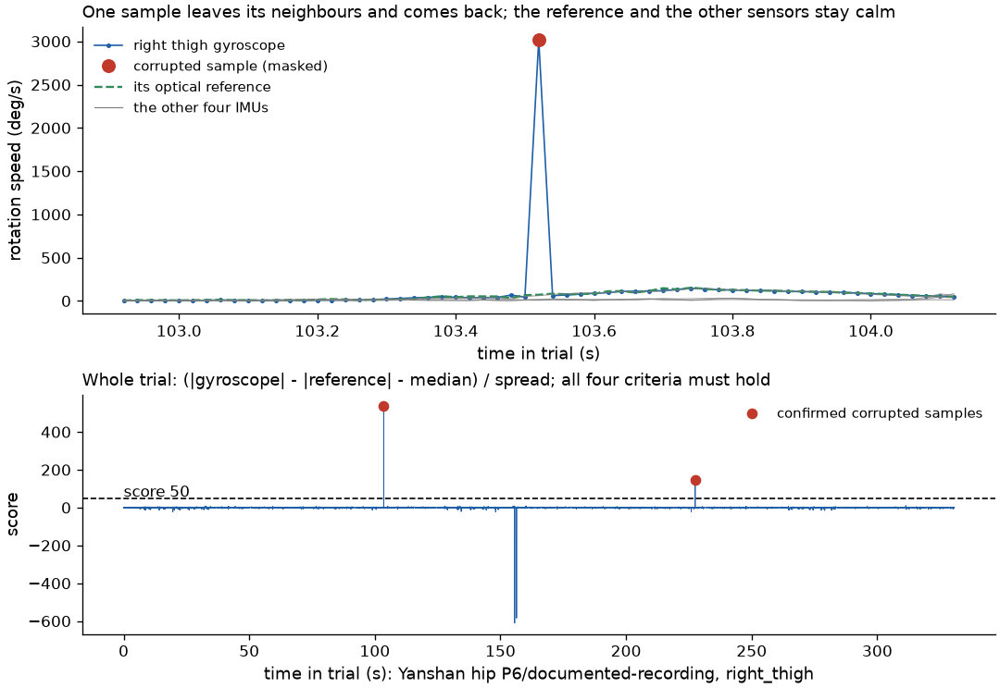

# Error 15 - Corrupted single samples

[Back to the error catalogue](../../README.md#the-errors) · Module: [`e15_corrupted_samples.py`](../../src/imunity/errors/e15_corrupted_samples.py) · Known-answer test: [`tests/test_e15_corrupted_samples.py`](../../tests/test_e15_corrupted_samples.py) · What happens to the data: **mask**

## What it is

One or two IMU samples hold a value the sensor cannot have measured, while the samples on both sides agree with each
other (for example two consecutive gyroscope samples at +5,169 and -5,117°/s between neighbours at 25°/s). A single
such sample, integrated, turns the estimate by several degrees at once, and it pulls every later fit (offset, signs,
mounting).

## How we find it

The check runs after the time alignment (errors 11-14), so the aligned reference can judge each suspicious sample.
Mounting, gyroscope offset and sign errors are not corrected yet, so only rotation speeds (vector lengths) are
compared. All four criteria must hold:

1. **Needle.** A run of 1 or 2 samples leaves its two outer neighbours and comes back: the out-and-back jump is at
   least `NEEDLE` = 0.9 times the largest rotation speed among the run and its neighbours. Runs of 2 are looked for
   first, so a corrupted pair is judged against the samples outside it.
2. **Score.** The whole-trial score of each sample of the run, (|gyroscope| - |reference rate| - median) / spread,
   with median and spread (1.4826 x median absolute deviation) over all valid samples of the segment, exceeds
   `SCORE` = 50 in absolute value, all in the same direction.
3. **Reference.** The reference does not show the jump: at every sample of the run the reference speed lies closer to
   the mean speed of the two outer neighbours than the gyroscope speed does.
4. **One sensor.** Corruption is a fault of one sensor, while an impact (a foot stomp) shakes several at once: no
   other IMU of the recording scores above 50 within one sample of the run.

Only upward needles are counted. Downward needles that meet criteria 1-3 are reported but not masked: in the data
they are almost all real reversals of the direction of rotation, which this rule cannot tell from a dropout. Where the
reference is missing at an upward needle, it is counted as not examined. The accelerometer cannot be judged by the
reference at this stage; its needles are confirmed only where the gyroscope of the same IMU has a corrupted run at
the same samples. NEEDLE and SCORE were chosen after scanning the datasets (exploratory). Known limit: an impact the
gyroscope catches, the smoother reference does not, and the other sensors feel only weakly, still passes.

## How we correct it

The samples of a confirmed run are marked invalid (all channels of that IMU sample).

Position in the agreed order: after the time alignment (errors 11-14), before every fit of the IMU signal (errors
16-22), which one such sample would pull.

## Where it occurs

Corrupted samples in the 15 datasets of the paper: **77**. Camargo 2, Darmstadt stairs 23, Geneva 2, Hankyong 5,
OpenSense 1, TUK 1, Yanshan hip 43 (all on one faulty sensor). Looked for and not found: Central Florida walking,
Delaware compliant terrain, IS2B, Trento, ULTRA-MoCap, dfjimu, DIODEM, REEM-C.

## Worked example: Yanshan hip, participant P6, right thigh IMU



Top: one gyroscope sample of the right thigh reads about 3,000°/s between neighbours at 44 and 62°/s, while its
optical reference (green) moves at 69°/s and the other four IMUs (grey) stay calm. Bottom: the score of every sample
over the whole trial. The sample at 103.5 s scores 640, far above 50; together with a second one at 228 s, two samples
are confirmed and masked in this trial (red). The large negative excursion near 157 s is a downward needle: it is
reported, not counted or masked, since a real reversal of rotation looks the same. In this dataset all confirmed
corrupted samples belong to the right thigh sensor.

## Functions

```python
from imunity.datasets import load_dataset
from imunity.errors import check_for_corrupted_samples, remove_corrupted_samples, handle_corrupted_samples

rec = load_dataset('hip_rom_y').load('P6/documented-recording')
result = check_for_corrupted_samples(rec)       # per segment: gyro_runs with score, jump, reference, impact
fixed = remove_corrupted_samples(rec)           # confirmed upward runs marked invalid
report = handle_corrupted_samples(['hip_rom_y'], data='in_order')   # after the time alignment, as in the order
```

On data as deposited the check runs without the time alignment; for datasets with a large time offset run it on data
corrected up to error 14 (`correct_in_order(dataset, up_to=14)`).
