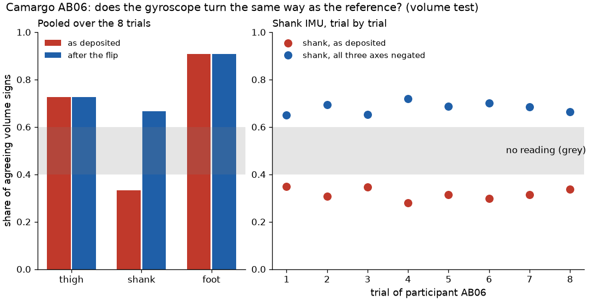

# Error 16 - Mirrored gyroscope or single flipped axis

[Back to the error catalogue](../../README.md#the-errors) · Module: [`e16_mirrored_gyroscope.py`](../../src/imunity/errors/e16_mirrored_gyroscope.py) · Known-answer test: [`tests/test_e16_mirrored_gyroscope.py`](../../tests/test_e16_mirrored_gyroscope.py) · What happens to the data: **fix**

## What it is

The gyroscope is stored mirrored: all three axes or one axis negated, so its frame is left-handed. This is a sign
error in the sensor's firmware, its export or a loader. Against the optical reference, a correctly stored gyroscope
differs only by a rotation (the mounting); a mirrored one by a rotation combined with a mirror, which no mounting
rotation can absorb. An estimator then turns the wrong way about one axis.

## How we find it

Two readings; a gyroscope counts as mirrored only if both say so. Where they disagree, or the motion is too planar to
read, it is undecided and reported, not corrected.

1. **Fit test**: the best rotation and the best mirror image mapping the gyroscope onto the reference's angular rate
   (both after removing the means, so a gyroscope offset does not enter); the better fit wins.
2. **Volume test**: for random triples of moving samples, the sign of the volume spanned by the three gyroscope rates
   (determinant of the 3x3 matrix) is compared with the sign of the volume of the three reference rates at the same
   moments. A rotation keeps the sign, a mirror flips it. Only well-spread triples count (|det| at least 0.40 of the
   product of the three lengths); fewer than 100 such triples give no reading. The share of agreeing signs decides:
   below 0.4 mirrored, above 0.6 right-handed, in between no reading (right-handed sensors read a median of 0.95 in
   the datasets, while 0.40-0.50 are coin flips).

The reference rate is differenced over 0.04 s, not frame to frame, so marker jitter does not swamp it; only samples
faster than 0.5 rad/s carry a direction.

**Pooling.** The handedness is read over all trials of one sensor on one participant, split into separate sessions
where the sensor was clearly remounted (its best map differs by more than 30° from the session's first trial). A
session other than the sensor's largest is marked `split_off` and reported apart, since a broken trial (wrongly paired,
on the wrong segment) can split off and read mirrored as well as a remounted sensor.

## How we correct it

Against the reference alone, negating one axis or all three fit equally well (one axis = all three plus a 180° turn,
which the mounting rotation absorbs). The accelerometer, which shares the gyroscope's frame, decides: for each
candidate (x, y, z, all three) a rotation-free cross-check (`accelerometer_cross_check.py`) gives the slope of the
measured gyroscope · accelerometer product on the one the reference predicts, about ±1 for the right candidate. The
candidate with the largest |slope| wins if its 99 % interval excludes zero and lies wholly beyond the runner-up's;
otherwise all three axes are flipped and the axis is recorded as open.

Position in the agreed order: after the corrupted samples (error 15), before the gyroscope offset (error 17), so the
offset's fallback fit against the reference sees a right-handed gyroscope. The readings need the time alignment.

## Where it occurs

Mirrored IMU streams in the 15 datasets of the paper: **38**. Camargo 8, Geneva 2, Hankyong 1, Trento 19 (participant 9,
trunk), ULTRA-MoCap 8. Looked for and not found in the other 10 datasets. Trento is counted after its re-pairing (error
8); on its deposited pairing the count is 10.

## Worked example: Camargo, participant AB06, shank IMU



Left: the volume test pooled over the participant's 8 treadmill trials. The thigh (0.73) and the foot (0.91) IMUs turn
the same way as their references; the shank's gyroscope agrees in only 0.33 of the triples, below 0.4 (grey band: no
reading). The fit test agrees: the best mirror image fits slightly better than the best rotation (123 against
126°/s rms misfit). Right: the shank reads mirrored in every single trial (0.28-0.35), not only on average. The
accelerometer cross-check could not single out one axis (its slopes for x, y and z did not separate clearly), so all
three axes are negated; afterwards the shank reads right-handed in every trial (0.65-0.72).

## Functions

```python
from imunity.datasets import load_dataset
from imunity.errors import check_for_mirrored_gyroscope, remove_mirrored_gyroscope, handle_mirrored_gyroscope

loader = load_dataset('camargo')
recs = [loader.load(t) for t in loader.trials() if t.startswith('AB06/')]   # all trials of one participant
result = check_for_mirrored_gyroscope(recs)          # per segment: sessions with both readings, flip decided
fixed = [remove_mirrored_gyroscope(r, result) for r in recs]
report = handle_mirrored_gyroscope(['camargo'], data='in_order')
```
