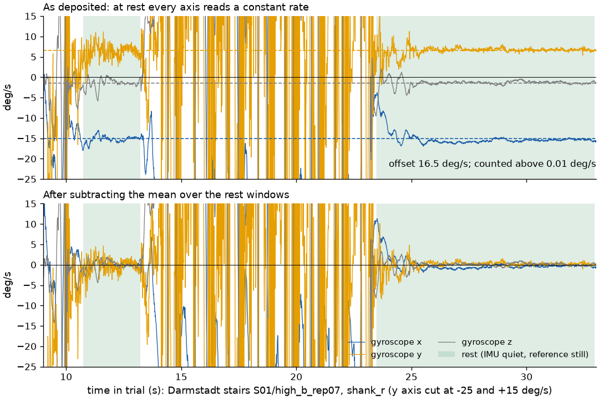

# Error 17 - Gyroscope offset

[Back to the error catalogue](../../README.md#the-errors) · Module: [`e17_gyroscope_offset.py`](../../src/imunity/errors/e17_gyroscope_offset.py) · Known-answer test: [`tests/test_e17_gyroscope_offset.py`](../../tests/test_e17_gyroscope_offset.py) · What happens to the data: **fix**

## What it is

A gyroscope at rest reads a small constant rate instead of zero (its zero-rate offset, or bias). Integrated, it makes
the orientation drift steadily. Calibrated units read about 0.2-0.6°/s; uncalibrated ones in the deposits up to
27°/s, which integrates to a full turn in under 15 s.

## How we find it

At rest the true rate is zero, so the mean of each raw axis is its offset, whatever the axis signs, the mounting or
the reference.

1. **Rest.** A window of 0.5 s (overlapping by half) is at rest when the IMU is quiet *and* the optical reference is
   still; both, so that a constant rotation is not taken for rest and reference jitter alone does not make a moving
   sensor look still.
   - IMU quiet: the accelerometer length varies by less than `MAX_ACC_STD` = 0.2 m/s² and every gyroscope axis by
     less than `MAX_GYR_STD_DPS` = 4.3°/s (standard deviation over the window: the spread, not the level, so an
     offset does not hide the rest).
   - Reference still: the net rotation of the reference over the window, divided by its duration, is below
     `MAX_REF_DPS` = 7.5°/s, and the reference is valid throughout. Net rotation, not frame-to-frame speed: marker
     jitter differentiated frame by frame reads 2-9°/s on still references.
   Each limit is 1.5 times the largest value in the static recordings the datasets ship: 2.87°/s gyroscope spread
   (a person standing in an N-pose), 4.98°/s net reference rotation (Hankyong N-pose, head cluster, body sway),
   0.132 m/s² accelerometer spread (Geneva). On a table the net rotation is 0.02-0.03°/s; a constant rotation slower
   than 7.5°/s can still pass for rest.
2. **Per trial.** A trial's offset is the mean gyroscope reading over its rest samples if it has at least 1 s of rest;
   otherwise the rest samples of all trials of the session are pooled. Without enough rest in the session either, an
   offset can only come from a fit against the reference rate (`reference_fallback=True`); the dataset-level check
   uses rest only.
3. **Decision.** An offset larger than `THRESHOLD_DPS` = 0.01°/s counts: the specified bias stability of the sensors
   in these datasets is 0.003-0.006°/s, so an offset removed at the start would stay below 0.01°/s.

## How we correct it

Each trial's estimated offset is subtracted from every gyroscope sample of that segment.

Position in the agreed order: after the mirrored gyroscope (error 16), before the mounting rotation (error 18), whose
fit uses the corrected gyroscope.

## Where it occurs

IMU streams with an offset above 0.01°/s in the 15 datasets of the paper: **10,831**, in all 14 datasets with rest.
Camargo 26, Central Florida walking 221, Darmstadt stairs 3,965, Geneva 2,305, Hankyong 2,377, IS2B 104, OpenSense 72,
Trento 1,283, TUK 285, ULTRA-MoCap 8, Yanshan hip 80, dfjimu 29, DIODEM 55, REEM-C 21. Not checkable (no rest):
Delaware compliant terrain. Trento is counted after its re-pairing (error 8); on its deposited pairing the count is
1,288.

## Worked example: Darmstadt stairs, participant S01, trial high_b_rep07, right shank



Top: the three gyroscope axes of the right shank (y axis cut at -25 and +15°/s to show the rest level; the stair
climbing in between goes far beyond). In the two rest stretches (green: IMU quiet and reference still) the axes do not
read zero but -15.1, +6.5 and -1.4°/s (dashed lines), an offset of 16.5°/s. Across the six IMUs of this trial the
offsets range from 8.2 to 21.1°/s. Bottom: after subtracting the mean over the rest windows, every axis reads zero at
rest.

## Functions

```python
from imunity.datasets import load_dataset
from imunity.errors import check_for_gyroscope_offset, remove_gyroscope_offset, handle_gyroscope_offset
from imunity.errors.e17_gyroscope_offset import rest_mask

rec = load_dataset('grimmer_stairs').load('S01/high_b_rep07')
result = check_for_gyroscope_offset(rec)          # pass a list of a session's trials to pool their rest
fixed = remove_gyroscope_offset(rec, result)
still = rest_mask(rec['shank_r'])                 # the rest samples the estimate uses
report = handle_gyroscope_offset(['grimmer_stairs'])
```
