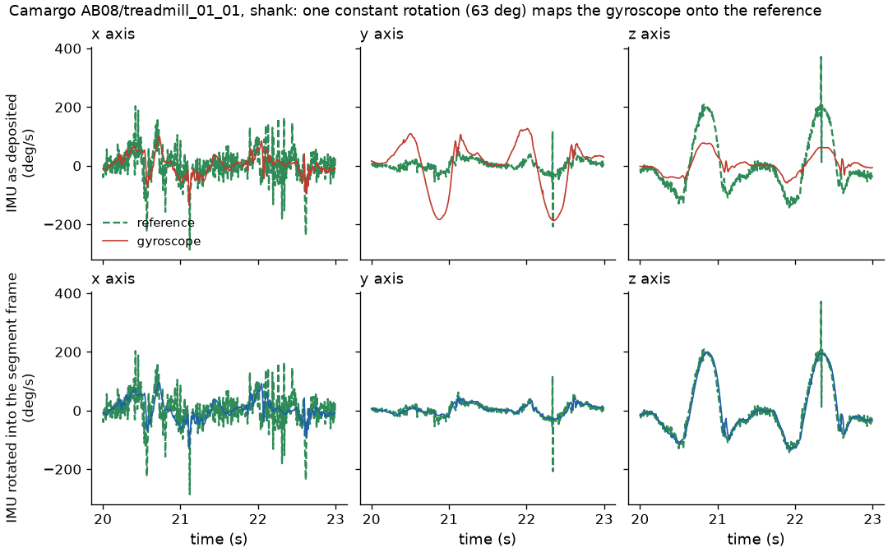

# Error 18 - Mounting rotation

[Back to the error catalogue](../../README.md#the-errors) · Module: [`e18_mounting.py`](../../src/imunity/errors/e18_mounting.py) · Known-answer tests: [`tests/test_e18_mounting_*.py`](../../tests/) (convergence, handler, no information, own window, slow motion, weighted mean, averaged rates) · What happens to the data: **fix**

## What it is

The IMU's axes are not aligned with the axes of the optical segment frame, and the deposit does not say (or says
wrongly) how they are rotated against each other. The relative orientation of two IMUs then mixes the joint's motion
with two unknown mounting rotations, so it cannot be compared with the reference joint angle. Every IMU has some
mounting rotation; it is a property of the setup more than a defect, which is why it is not counted.

## How we find it

The gyroscope measures the angular rate in the sensor frame; the reference gives it in the segment frame. If the IMU
is rigidly mounted, one constant rotation maps one onto the other. The best such rotation over the moving samples
(least squares) is the mounting rotation; the fit also tells how the reference stores its
orientation (segment-to-world or the reverse) and how well a rotation explains the data at all.

In the agreed order:

1. **Own fit.** One rotation per trial and segment, fitted on the trial's first 10 s of motion from the motion onset
   (the estimators' unscored convergence time), using every sample in which the segment is not at rest (rates
   averaged over 0.25 s, above the rest limit of 7.5°/s).
2. **Uncertainty.** Each fit carries an information matrix: how well the data pin down the rotation about each axis.
   The noise is estimated with neighbouring samples counted as correlated over 0.25 s (the measured memory of the
   misfit), never below the reference's jitter at rest, and widened for short stretches. A segment turning about one
   axis only determines the rotation about the other two well.
3. **Weighted mean.** The rotation applied is the certainty-weighted mean of the trial's own fit and the pool of the
   participant's other trials, so a well-determined own fit keeps its weight and the pool fills in the directions the
   own fit does not determine. A fit that knows nothing (a still segment) is not applied.
4. **Own window.** A segment without a pool that moves in at most half of the trial's 10 s window (or whose fit there is
   useless) is fitted on its own first 10 s of motion faster than 15°/s (twice the rest limit), and its joints are
   scored only from the end of that window. A fit that knows nothing in any direction is not applied; a segment left
   with nothing else stays uncorrected and is logged.

Counted (by the handler): trial-segments whose applied rotation exceeds 2°; segments without any rotation are
undecided.

## How we correct it

The gyroscope and accelerometer samples are rotated by the applied rotation, so the IMU data are expressed in the
reference segment frame. This needs synchronised streams, which is why it comes after all timing errors.

Position in the agreed order: after the gyroscope offset (error 17), before the accelerometer checks (errors 19-22),
which need the sensor turned into the segment.

## Where it occurs

The mounting rotation concerns every IMU and is reported as an angle, not counted as an occurrence.

## Worked example: Camargo, participant AB08, treadmill trial 01, shank



Top: the three axes of the shank's gyroscope (red) against the reference's angular rate in the segment frame (green
dashed), over three seconds of walking. Axis by axis they do not match: the large swing of the gait cycle appears on
the gyroscope's y axis but on the reference's z axis. The fit on the first 10 s of motion finds a rotation of 63°
between the two frames (the thigh and foot of the same trial need 157° and 173°). Bottom: after rotating the IMU data (blue) by
it, each gyroscope axis lies on the corresponding reference axis.

## Functions

```python
from imunity.datasets import load_dataset
from imunity.errors import (check_for_mounting_in_convergence, check_for_mounting_misalignment,
                            remove_mounting_misalignment, handle_mounting)

rec = load_dataset('camargo').load('AB08/treadmill_01_01')
result = check_for_mounting_in_convergence(rec)      # per segment: angle, fit, information, uncertainty_deg
fixed = remove_mounting_misalignment(rec, result)    # IMU data rotated into the segment frames
whole = check_for_mounting_misalignment(rec)         # one rotation over the whole trial (or a list of trials)
report = handle_mounting(['camargo'], data='in_order')   # own fit weighted with the participant's other trials
```
