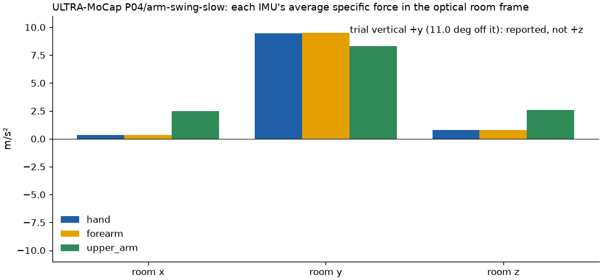

# Error 19 - Reference vertical not +z

[Back to the error catalogue](../../README.md#the-errors) · Module: [`e19_e20_accelerometer_sign.py`](../../src/imunity/errors/e19_e20_accelerometer_sign.py) (shared with error 20) · Known-answer test: [`tests/test_e19_e20_accelerometer_sign.py`](../../tests/test_e19_e20_accelerometer_sign.py) · What happens to the data: **report**

## What it is

The optical system's room frame has some axis pointing up. Many tools (and many readers of a deposit) assume it is
+z; in several deposits it is +y or another axis, and it may change between sessions. Anyone who uses the reference's
absolute orientation, for example to compare an IMU's inclination with it or to initialise a filter from it, then
gets gravity in the wrong direction. A relative orientation (joint angle) is not affected, because a common turn of the
whole room cancels.

## How we find it

The check is a by-product of the accelerometer sign check (error 20), which needs each trial's true vertical anyway.

1. **Room-frame average per unit.** Averaged over a trial, the specific force an accelerometer measures, carried into
   the room frame, is gravity's reaction plus the velocity change over the trial: a vector of about 9.81 m/s² along
   the room's vertical. Each accelerometer is carried into the segment frame by a rotation fitted from the gyroscope
   alone against the reference's rotation rate (no accelerometer enters it), then into the room by the reference
   orientation, and averaged.
2. **The trial's vertical.** All units of one trial share one coordinate system. Each unit's average is compared with
   the common axis of the trial's other readable units (leave one out, sign ignored); units within
   `AXIS_TOLERANCE_DEG` = 46.6° of it fit (the 99th percentile of that angle over 14,311 unit-trials). With at least
   two fitting units, their common axis is the trial's vertical and the majority of them sets which way it points;
   with fewer, +z is assumed and the trial is reported (`vertical_assumed`).
3. **Report.** The vertical's angle to the nearest signed coordinate axis is reported. Below `AXIS_NAMED_DEG` = 30°
   that axis is named (for example `+y`); a trial whose vertical is named and is not `+z` is counted. From 30° on no
   axis is named and the trial is reported as suspicious, not counted.

Not checkable where every unit's gravity was removed (error 22), since an average shorter than half of gravity has no
direction.

## How we correct it

It is reported only; nothing in the data is changed. The relative orientation is not affected by a common turn of the
room, and the later accelerometer checks use the vertical found here, whatever axis it is.

Position in the agreed order: after the mounting rotation (error 18), together with error 20.

## Where it occurs

Trials whose vertical is not +z in the 15 datasets of the paper: **215**. Camargo 10, Geneva 45, Trento 14, ULTRA-MoCap
146. Looked for and not found in 10 datasets. Not checkable (gravity removed): Yanshan hip. Trento is counted after its
re-pairing (error 8); on its deposited pairing the count is 83.

## Worked example: ULTRA-MoCap, participant P04, slow arm swing



Each bar group is one room axis; each colour one IMU's average specific force over the trial, carried into the optical
room frame. All three IMUs (hand, forearm, upper arm) agree that "up" is room +y (about 8-9.5 m/s² along y, little
along x and z). The trial's common vertical lies 11.0° from +y, below the 30° that names an axis, so the trial is
reported with vertical `+y`. Nothing is changed; the accelerometer sign check (error 20) compares each unit with this
vertical.

## Functions

```python
from imunity.datasets import load_dataset
from imunity.errors import check_for_negated_accelerometer, handle_reference_vertical

rec = load_dataset('ultramocap').load('P04/arm-swing-slow')
result = check_for_negated_accelerometer(rec, cross_check=False)
print(result.thresholds['trial_verticals'])    # per trial: up vector, named axis, its angle, votes
report = handle_reference_vertical(['ultramocap'])
```
