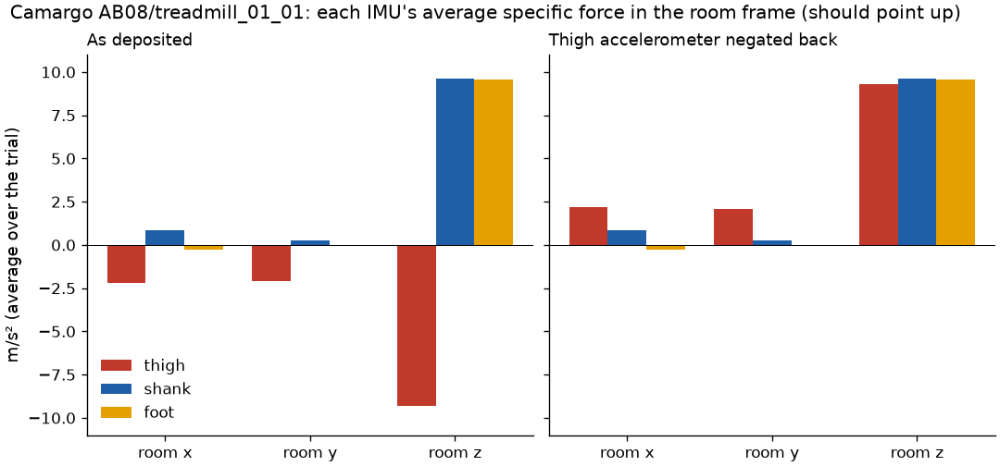

# Error 20 - Accelerometer negated

[Back to the error catalogue](../../README.md#the-errors) · Module: [`e19_e20_accelerometer_sign.py`](../../src/imunity/errors/e19_e20_accelerometer_sign.py) (shared with error 19) · Known-answer tests: [`tests/test_e19_e20_accelerometer_sign.py`](../../tests/test_e19_e20_accelerometer_sign.py), [`tests/test_e20_accelerometer_cross_check.py`](../../tests/test_e20_accelerometer_cross_check.py) · What happens to the data: **fix**

## What it is

The accelerometer reports the negative of the specific force on all three axes: a sign setting in the sensor, its
export or a loader that hits the accelerometer only (the gyroscope in the same housing is already right-handed, error
16 runs before). An estimator that uses the accelerometer to find "down" then believes the sensor is upside down and
corrects its inclination the wrong way.

## How we find it

1. **Main reading.** As for [error 19](19-reference-vertical-not-z.md): each unit's room-frame average specific force
   (about 9.81 m/s² along the room's vertical; a negated accelerometer gives exactly the negative), and each trial's
   vertical from the majority of its units. A unit pointing against its trial's vertical is negated in that trial;
   outside the tolerance of 46.6° it is unreadable there. The mounting rotation used here is fitted from the
   gyroscope alone and only serves as a measuring tool; the data are not rotated by it.
2. **Pooling.** Per sensor, participant and mounting session (sessions as for the mirrored gyroscope), the trial
   verdicts are weighted by valid samples; more than half negated: negated, exactly half: undecided.
3. **Second reading.** A rotation-free cross-check (`accelerometer_cross_check.py`) on the same sessions and
   verticals: the slope of the measured gyroscope · accelerometer product on the one the reference predicts, about +1
   for a correct and -1 for a negated accelerometer. A session counts as negated only if both readings say so and it
   is not a single trial split off from its sensor. A session the main reading calls correct and the cross-check
   negated is undecided; where the cross-check cannot read, nothing is negated.
4. **Limits.** An average shorter than half of gravity has no direction (this is where removed gravity, error 22,
   shows). Every unit of a trial negated alike is not detectable, and harmless, since a common turn of the whole room
   cancels in the relative orientation; where most units of a trial are negated, the correct minority is flagged
   instead. Single negated axes and swapped axes are not read: in walking, wrong axis orders gave trial averages
   longer and more upward than the right one, so no axis-level rule held.

## How we correct it

The three accelerometer columns are negated in every trial of a negated sensor-session.

Position in the agreed order: after the mounting rotation (error 18) and the reference vertical (error 19), before the
accelerometer bias (error 21).

## Where it occurs

Negated sensor-sessions in the 15 datasets of the paper: **9**. Camargo 8 (thigh IMUs), Geneva 1. Looked for and not
found in 12 datasets. Not checkable (gravity removed): Yanshan hip.

## Worked example: Camargo, participant AB08, treadmill trial 01



Each bar group is one room axis; each colour one IMU's average specific force over the trial, in the optical room
frame. As deposited (left), the shank and foot accelerometers point up (+9.6 m/s² along z), the thigh's points down
(-9.3 m/s²). The cross-check agrees (slope -0.35 for the thigh, its 99 % interval below zero; +0.83 and +0.85 for shank
and foot), so the thigh's session is negated. After its three columns are negated (right), all three point up.

## Functions

```python
from imunity.datasets import load_dataset
from imunity.errors import check_for_negated_accelerometer, remove_negated_accelerometer, handle_negated_accelerometer

loader = load_dataset('camargo')
recs = [loader.load(t) for t in loader.trials() if t.startswith('AB08/')]   # pool a participant's trials
result = check_for_negated_accelerometer(recs)     # per segment: sessions, both readings, verdict and reason
fixed = [remove_negated_accelerometer(r, result) for r in recs]
report = handle_negated_accelerometer(['camargo'], data='in_order')
```
