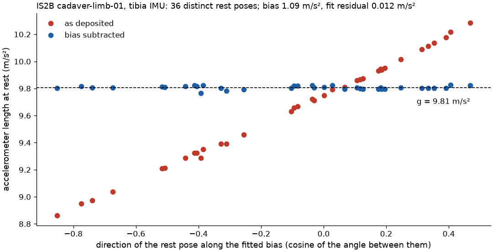

# Error 21 - Accelerometer bias

[Back to the error catalogue](../../README.md#the-errors) · Module: [`e21_accelerometer_bias.py`](../../src/imunity/errors/e21_accelerometer_bias.py) · Known-answer test: [`tests/test_e21_accelerometer_bias.py`](../../tests/test_e21_accelerometer_bias.py) · What happens to the data: **fix**

## What it is

A constant offset in the accelerometer: at rest the sensor reads gravity plus that offset, so the length is not
9.81 m/s² in every pose. An estimator that takes the accelerometer as the direction of gravity is tilted by up to
asin(bias / g), about 6° for a bias of 1 m/s².

## How we find it

The rest-pose rule:

1. **Rest readings.** Rest is the gyroscope-offset check's rest (IMU quiet, the accelerometer's length varying by less
   than 0.2 m/s², optical reference still). Each rest stretch is cut into 0.5 s pieces; the mean accelerometer of a
   piece is one rest reading. Rest is found by how much the accelerometer's length varies, not by its size, so a
   constant bias does not change which stretches count.
2. **Poses.** Readings closer than 3.75° in direction are one pose (the most a segment can turn within one reading
   under the reference's rest limit of 7.5°/s).
3. **Sphere fit.** With at least 8 poses whose directions do not lie in one plane (smallest eigenvalue of their mean
   outer product at least 0.05), the bias b is the centre of the sphere of radius g through the readings
   (|a - b| = g, least squares). It is read if the fit's rms residual is at most 0.05 m/s² and |b| at least
   0.2 m/s²; otherwise it is not corrected and the verdict says why ("too few poses", "poses in one plane", ...).
4. **Pooling.** One bias per sensor and participant, over all its trials. This assumes the sensor was not switched off
   between trials (an accelerometer's offset may change at each switch-on); pooled per documented session instead,
   the poses usually lie in one plane and nothing can be read.
5. Units with gravity removed (error 22: median rest length below half of gravity) are skipped; a sphere of radius g
   through readings near zero would read a "bias" of g.

A scale error is not fitted.

## How we correct it

The bias is fitted in the sensor's own frame (the data before the mounting rotation). At its place in the order the
accelerometer has been rotated (error 18) and maybe negated (error 20); that map is recovered from the accelerometer
before the mounting correction and as it now stands (the same samples, turned), and the bias is turned by it before it
is subtracted.

Position in the agreed order: after errors 18-20, before gravity removed (error 22).

## Where it occurs

Sensors with a bias read, in the 15 datasets of the paper (on the data corrected for all earlier errors): **2**, both in
IS2B. Judged and not found: Trento, dfjimu, DIODEM. Not checkable (no sensor with at least 8 rest poses
off one plane, or gravity removed): the other 11 datasets.

## Worked example: IS2B, cadaver limb 01, tibia IMU



The cadaver limb rests in many orientations across the participant's trials; the rest readings give 36 distinct poses.
As deposited (red), the accelerometer length at rest depends on the pose: from 8.9 m/s² when the sensor's bias points
against gravity to 10.3 m/s² when it points with it (x axis: cosine between the pose and the fitted bias). The sphere
fit finds a bias of 1.09 m/s², almost entirely along the sensor's z axis, with an rms residual of only 0.012 m/s².
After subtracting it (blue), every pose reads 9.81 m/s². The femur IMU of the same limb reads a bias of 0.90 m/s².

## Functions

```python
import numpy as np
from imunity.datasets import load_dataset
from imunity.errors import handle_accelerometer_bias
from imunity.errors.e21_accelerometer_bias import judge_unit, remove_accelerometer_bias, rest_readings

loader = load_dataset('is2b')
readings = np.vstack([rest_readings(loader.load(t)['tibia']) for t in loader.trials()])   # one sensor, pooled
print(judge_unit(readings))                       # verdict, poses, spread, residual, bias_x/y/z
report = handle_accelerometer_bias(['is2b'], data='in_order')   # bias per sensor and participant, turned and subtracted
```

`remove_accelerometer_bias(rec, biases, acc_in_sensor_frame)` subtracts given biases from a single recording; it needs
the accelerometer as it was before the mounting correction to turn each bias into the current frame.
