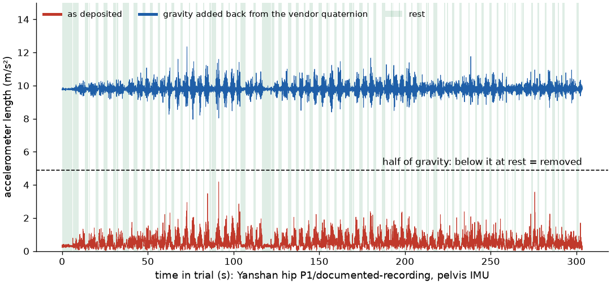

# Error 22 - Gravity removed from the accelerometer

[Back to the error catalogue](../../README.md#the-errors) · Module: [`e22_gravity_removed.py`](../../src/imunity/errors/e22_gravity_removed.py) · Known-answer test: [`tests/test_e22_gravity_removed.py`](../../tests/test_e22_gravity_removed.py) · What happens to the data: **fix**

## What it is

The depositors stored the accelerometer with gravity subtracted, for example because the vendor's firmware writes the
gravity-compensated "linear acceleration". It is a processing choice, reported as such, but the estimators need
gravity to know which way is down: without it their inclination is unobservable.

## How we find it

At rest an accelerometer reads gravity, 9.81 m/s², in any pose. A sensor whose median accelerometer length over its
rest samples (the gyroscope-offset check's rest: IMU quiet and optical reference still) is below
`MAX_REST_LENGTH_G` = 0.5 of gravity has its gravity removed. No rotation or mounting enters, so a poor mounting fit
cannot shorten it. In the datasets the affected sensor-trials read 0.08-0.36 m/s² and every other one at least
8.9 m/s², a wide gap. A sensor-trial with less than 1 s of rest is not judged. One occurrence per sensor and trial.

## How we correct it

The firmware subtracted gravity as it saw it: its own orientation estimate turned the room's "up" into the sensor
frame, and that vector times 1 g was taken off every sample. The deposit keeps that orientation estimate, the vendor
quaternion (one per sample). Adding the same vector back gives the specific force the sensor measured:

    a_restored(t) = a_deposited(t) + g * R_vendor(t)^T e_z

with R_vendor the sensor-to-room rotation of the quaternion, e_z the room's up and g = 9.8 m/s² (the deposit's own
scale constant). Checked on the deposit: the quaternion's frame-to-frame rotation matches the gyroscope (correlation
0.98-1.00), its room is +z up, and the restored length at rest is 9.78-9.84 m/s². Only the quaternion's tilt enters; its
tilt errors enter the restored accelerometer. Assumed, not tested: that the firmware subtracted exactly this vector
(not, for example, a low-passed one). The optical reference is not used, so the restored IMU data stay independent
of the reference they are scored against.

The reader carries the vendor quaternion and the accelerometer as read in `recording.metadata['segments'][name]`
(keys `vendor_quaternion_wxyz` and `acc_as_read`). Because this comes after the mounting rotation, the vector is
turned by the rotation applied to the accelerometer since it was read, recovered from the accelerometer as read and as
it now stands. Samples without a quaternion take their neighbour's and are marked invalid.

Position in the agreed order: last, after the accelerometer bias (error 21).

## Where it occurs

IMU streams with gravity removed in the 15 datasets of the paper: **80**, all in Yanshan hip (every stream). Looked for
and not found in 13 datasets. Not checkable (no rest): Delaware compliant terrain.

## Worked example: Yanshan hip, participant P1, pelvis IMU



As deposited (red) the pelvis accelerometer's length stays around 0.3 m/s² at rest (green) and rarely exceeds 3 m/s²
in motion: no gravity. It lies below half of gravity (dashed) at rest, so gravity is removed; all five IMUs of this
trial read the same. With gravity added back from the vendor quaternion (blue) the length is 9.8 m/s² at rest and
varies around it in motion, as an accelerometer's should.

## Functions

```python
from imunity.datasets import load_dataset
from imunity.errors import check_for_gravity_removed, restore_removed_gravity, handle_gravity_removed

rec = load_dataset('hip_rom_y').load('P1/documented-recording')
result = check_for_gravity_removed(rec)        # per segment: median rest length (m/s²), rest seconds
fixed = restore_removed_gravity(rec)           # needs the vendor quaternion in rec.metadata['segments']
report = handle_gravity_removed(['hip_rom_y'])
```
